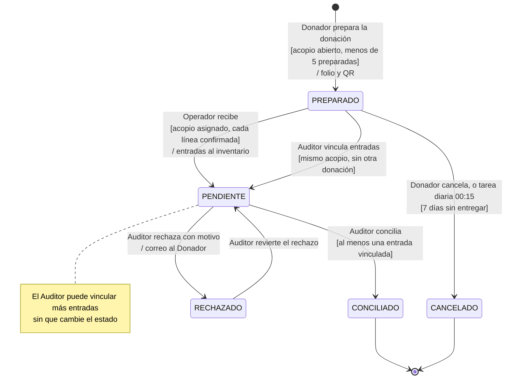

# Comportamiento

Diagramas de comportamiento de lo que ya está construido. Los PNG salen de esta nota con
`node diagramas/build.mjs` y `node diagramas/renderizar.mjs`, igual que los entidad-relación y el
C4.

## Ciclo de vida de la donación

El diagrama sigue a una donación (tabla `comprobante`, enum `EstadoComprobante`) desde que el
Donador la prepara en el portal hasta que un Auditor la concilia contra las entradas de
inventario o la rechaza. Corresponde a la historia
[HU-006](../01-requerimientos/historias/README.md) («Comprobar que mi donación llegó») y a los
requerimientos RF-CMP-001B (preparar), RF-CMP-001C (recibir), RF-CMP-004 (conciliar), RF-CMP-005
(rechazar) y RF-CMP-006 (seguimiento por folio), descritos en
[comprobantes.md](../01-requerimientos/funcionales/comprobantes.md). Las guardas son reglas de
negocio que la API hace cumplir: un Donador tiene como máximo cinco donaciones preparadas, una
preparada vence a los siete días, solo el Operador asignado al acopio la recibe y nadie concilia
sin una entrada vinculada. Elegimos un diagrama de estados porque en la donación intervienen
cuatro actores (Donador, Operador, Auditor y una tarea programada), y lo que cada uno puede hacer
depende del estado en que la encuentra. En un diagrama de actividades esas reglas quedarían
repartidas entre carriles, y costaría ver que un rechazo se puede revertir y una conciliación no.

Cada cambio de estado exige el estado anterior en el mismo `UPDATE` (`cambiarSiEstado` del DAO de
comprobantes). Si el Operador recibe un folio en el mismo instante en que la tarea diaria lo
cancela, una de las dos operaciones ya no encuentra la fila en `PREPARADO` y no cambia nada.

| Transición | Quién | Dónde vive en el código |
|---|---|---|
| inicio → PREPARADO | Donador | `DonacionesService.crear` (`comprobantes/donaciones.service.ts`) |
| PREPARADO → CANCELADO | Donador | `DonacionesService.cancelar` |
| PREPARADO → CANCELADO | Tarea `preparadas-vencidas`, 00:15 hora de Colombia | `TareasCustodiaService.cancelarVencidas` (`tareas-custodia.service.ts`) |
| PREPARADO → PENDIENTE | Operador del acopio | `RecepcionService.recibir` (`recepcion.service.ts`) |
| PREPARADO o PENDIENTE → PENDIENTE | Auditor o Admin con el acopio en su alcance | `ConciliacionService.vincular` (`conciliacion.service.ts`) |
| PENDIENTE → CONCILIADO | Auditor o Admin | `ConciliacionService.conciliar` |
| PENDIENTE → RECHAZADO | Auditor o Admin | `ConciliacionService.rechazar`, que encola el correo al Donador si tiene correo real |
| RECHAZADO → PENDIENTE | Auditor o Admin | `ConciliacionService.revertirRechazo` |

Los límites de cinco preparadas y siete días son los valores por defecto de `PREPARADAS_MAXIMO` y
`PREPARADA_VIGENCIA_DIAS` (`apps/api/src/config/entorno.ts`).
