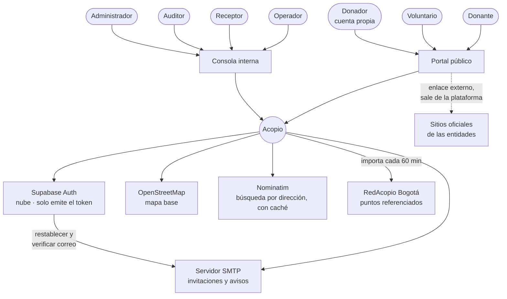
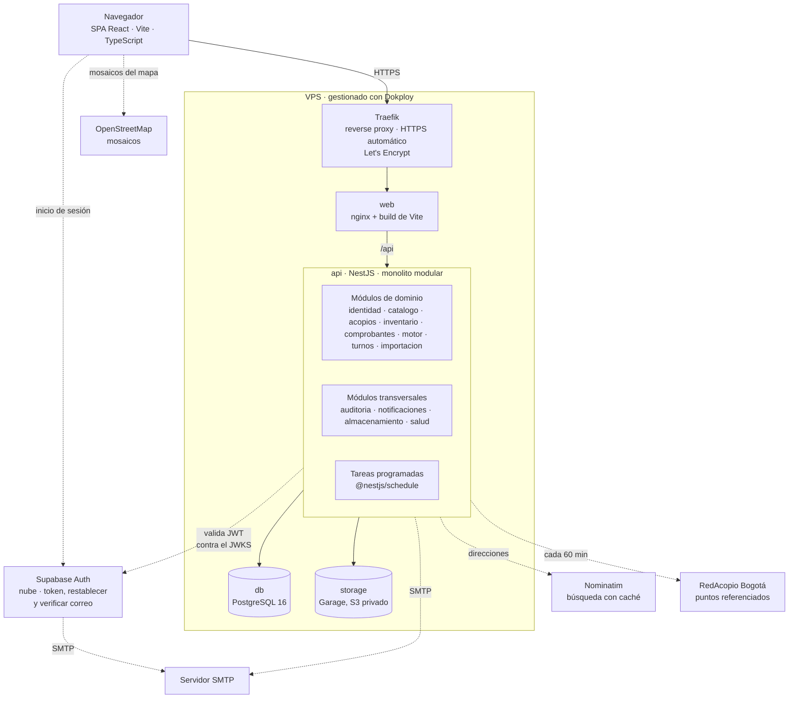

# Vista general de arquitectura

---

## C4 nivel 1 — Contexto



**Sale de la plataforma:** enlaces a los sitios oficiales de las entidades. La
donación de dinero ocurre allá, nunca aquí. Los cuatro roles internos —Operador,
Receptor, Auditor, Administrador— entran por la Consola. El Donador también tiene
cuenta, pero propia —se registra solo— y entra por el Portal público; el resto son
públicos, sin cuenta ([actores.md](../00-contexto/actores.md)).

## C4 nivel 2 — Contenedores



**Cómo leer el diagrama.** El navegador descarga la SPA desde `web` y habla con
la API por HTTPS en el mismo origen: Traefik entrega el dominio a `web`, y su nginx
pasa `/api` a la API; solo va directo a Supabase para iniciar
sesión y a OpenStreetMap por los mosaicos del mapa. La API es un único proceso con
once módulos —ocho de dominio y tres transversales— y sus tareas programadas; es la
única pieza que toca la base de datos, los archivos y los servicios externos: el
servidor SMTP para el correo, Nominatim para buscar direcciones y RedAcopio para
importar puntos referenciados. Supabase usa el mismo servidor SMTP para sus correos.

**El almacenamiento nunca se expone.** Es Garage, compatible con S3
([ADR-0012](adr/ADR-0012-almacenamiento-garage.md)); la API le habla por la API de
S3, así que cambiar de servidor es configuración. Todo archivo pasa por la API: la
foto de la factura la entrega la propia API, que revisa el permiso y lee el objeto de
Garage ([ADR-0017](adr/ADR-0017-factura-servida-por-la-api.md)). La evidencia de las
remisiones se sirve igual.

**Lo que corre hoy.** Mientras el desarrollo es local (P-032), todo se levanta con
Docker Compose: `db`, `storage` (Garage), `mailpit` para ver los correos, la `api` y
la `web` (nginx con el build, en el perfil `web`). Para trabajar en la interfaz se usa
Vite. El inicio de sesión
usa el adaptador `local` de `ProveedorIdentidad` (P-025); Supabase Auth entra con el
primer despliegue.

**No hay servicio `proxy`.** Traefik viene con Dokploy, recibe el dominio y emite el
certificado HTTPS. Lo entrega todo a `web`, y el nginx de `web` reenvía `/api` a la API. Detalle completo en
[despliegue.md](../06-operacion/despliegue.md#producción--vps-con-dokploy).

## Módulos del backend

Un módulo NestJS por límite de dominio. Sin dependencias circulares; cuando dos
módulos necesitan hablarse, lo hacen por una interfaz declarada, no importando
clases internas.

Construidos al 2026-10-21: `identidad`, `auditoria`, `catalogo`, `notificaciones`,
`salud`, `acopios` (con las causas), `inventario`, `comprobantes`, `almacenamiento`, `motor`
completo (cálculo, sugerencias, remisiones, recepción y reportes), `turnos` (Bloque 5) e
`importacion` (pieza E).

| Módulo | Responsabilidad | Expone |
|---|---|---|
| `identidad` | Usuarios, invitaciones, auto-registro de Donador, roles, asignaciones, guard | `AuthGuard`, `ScopeGuard`, `UsuarioService` |
| `catalogo` | Categorías, unidades, canasta, códigos de barras, emergencias | `CategoriaService`, `CanastaService` |
| `acopios` | Acopios operados y referenciados, zonas, entidades, causas y su archivado. Búsqueda por dirección con Nominatim y caché | `UbicacionService` |
| `inventario` | Movimientos, saldos, umbrales, no recibir | `MovimientoService`, `SaldoService` |
| `comprobantes` | Donaciones preparadas con folio, sugerencia de acopio, factura, recepción por folio, conciliación, seguimiento público y tareas de vencimiento y retención | `DonacionesService`, `RecepcionService`, `ConciliacionService` |
| `motor` | Necesidad, déficit, excedentes, sugerencias con su recálculo, pesos, remisiones y despacho general, vínculo folio–remisión, necesidad reportada. Las fórmulas viven en `packages/shared` | `EstadoMotorService`, `NecesidadService`, `SugerenciasService`, `ConfiguracionService`, `RemisionesBorradorService` |
| `turnos` | Jornadas de acopio y de entidad, reservas sin cuenta, aforo, asistencia, recordatorios y borrado de datos a los 30 días | `JornadasService`, `ReservasService` |
| `auditoria` | Bitácora. Cada servicio la escribe en la misma transacción que el cambio; no hay interceptor | `BitacoraService` |
| `notificaciones` | Correo por SMTP: invitaciones, reservas, avisos de folio y de acopio cerrado. Envío con reintentos | `NotificacionService` |
| `almacenamiento` | Archivos en Garage, por la API de S3: facturas, evidencias de remisión, documentos de verificación, logotipos e imágenes de causas y plataformas. La API lee el objeto y entrega los bytes | `AlmacenamientoService` |
| `importacion` | Puntos referenciados desde fuentes externas, un adaptador por fuente ([RF-RED-011](../01-requerimientos/funcionales/red.md#rf-red-011--importar-acopios-de-una-fuente-externa)) | `ImportadorService` |

**Validación del 2026-09-14 ([P-023](../01-requerimientos/pendientes.md)):**
`notificaciones` y `almacenamiento` salen como módulos transversales porque cuatro
y tres módulos, respectivamente, los necesitaban —antes el almacenamiento vivía
dentro de `comprobantes` y obligaba a `motor` a depender de él por una foto—.
`importacion` nace con los puntos referenciados. **No hay microservicios:** todo
corre en el mismo proceso, y `importacion` y `notificaciones` hablan con el exterior
a través de adaptadores, de modo que se podrían extraer más adelante sin tocar el
dominio.

### Dependencias permitidas

```
identidad      ← todos           (autorización)
auditoria      ← todos           (registro)
notificaciones ← identidad, acopios, comprobantes, turnos
almacenamiento ← acopios, comprobantes, motor, importacion
catalogo       ← inventario, comprobantes, motor, importacion
acopios        ← inventario, comprobantes, motor, turnos, importacion
inventario     ← comprobantes, motor, importacion
turnos         ← importacion
comprobantes   ← motor           (solo lectura, para trazabilidad)
```

`notificaciones` y `almacenamiento` no dependen de ningún módulo de dominio: son
hojas del grafo, y por eso no pueden crear ciclos. `importacion` está en la otra punta: escribe
en `acopios`, `catalogo`, `inventario` y `turnos` con sus servicios, y nadie la importa
(pieza E, 2026-10-18).

**2026-10-09.** `comprobantes` puede importar `catalogo`: lee categorías y códigos de
barras por sus DAO ([ADR-0019](adr/ADR-0019-dao-sobre-prisma.md)).

**2026-09-28 · construido en el Bloque 0.** Estas reglas las hace cumplir
dependency-cruiser en CI (`apps/api/.dependency-cruiser.cjs`). Dos piezas que no son
módulos de dominio: `comun/autorizacion` guarda los decoradores de rol y el tipo del
usuario autenticado, que usan todos los módulos —si vivieran en `identidad`, habría un
ciclo con `auditoria`—; y `salud` expone `GET /api/salud` para el chequeo del
contenedor.

**2026-09-30 · Bloque 1.** Nacen `acopios` (entidades, acopios, zonas, ubicaciones y
geocodificación) e `inventario`, que por ahora solo tiene «no recibir». `identidad`
valida las ubicaciones de una asignación por el puerto `VerificadorUbicaciones`: el
token vive en `comun/ubicaciones` y lo implementa `acopios`, que es global solo para
entregarlo. Es el mismo patrón de `ProveedorIdentidad`: ninguno de los dos módulos
importa al otro.

**2026-10-05 · Bloque 3.** Nacen `comprobantes` y `almacenamiento`, con las dependencias
de la tabla de arriba, que son las mismas de `.dependency-cruiser.cjs`. `almacenamiento`
envuelve un cliente S3 contra Garage (`AlmacenS3`) y un `AlmacenMemoria` para las
pruebas. `comprobantes` guarda el vínculo con los movimientos en
`comprobante_movimiento`, así que `inventario` no sabe nada de comprobantes.

## Diagrama de paquetes

Cada caja es una carpeta del repositorio, con su ruta escrita. Adentro van las clases,
interfaces y componentes que más pesan en ese paquete, con su nombre real. Una flecha
`A → B` dice que A importa algo de B. Las dependencias entre módulos de la API salen
del grafo que mide dependency-cruiser (`bun run --filter @acopio/api depcruise`) el
2026-10-19, no de la tabla de arriba: `acopios` todavía no importa `notificaciones`,
aunque la tabla lo permite.

Los dos diagramas se dibujan a mano en SVG en
[diagramas/paquetes.html](diagramas/paquetes.html), que también se publica como página
para verlos con zoom. Los PNG salen de ahí con `node exportar-paquetes.mjs`. En el de
la API no se dibujan las flechas hacia `auditoria` e `identidad`, que importan casi
todos los módulos: una flecha desde el grupo de dominio dice quiénes.

Convenciones de los dos diagramas:

- `«interfaz»` es un puerto: un contrato con más de una implementación, elegida por
  configuración o en las pruebas.
- `«controlador»` atiende rutas HTTP; `«servicio»` tiene la lógica y la transacción;
  `«guard»` corre antes de cada petición.
- Línea continua: importación en el código. Línea punteada: relación que no es un
  import, como una llamada HTTP o un archivo generado.

### Paquetes del monorepo


`apps/web` nunca importa código de `apps/api`. Lo que comparten pasa por dos caminos:
las funciones puras de `packages/shared` y el contrato OpenAPI, del que salen los tipos
del cliente.

### Paquetes de la API


Las flechas apuntan hacia abajo: un módulo solo importa a los que están debajo de él.
Las únicas importaciones hacia `identidad` son a `AlcanceService`, que dice qué acopios
y zonas puede tocar el usuario de la petición. `identidad` no importa `acopios`: valida
las ubicaciones de una asignación con el puerto `VerificadorUbicaciones` de `comun/`,
que `acopios` implementa. Las cuatro hojas no importan ningún módulo de dominio, y por
eso no pueden cerrar un ciclo. No se dibujan las flechas hacia `comun/`, `config/` y
`generado/`, porque las tienen todos los módulos. Tampoco `motor → packages/shared`,
que está en la vista del monorepo.

## Tareas programadas

Corren dentro del proceso de la API con `@nestjs/schedule`. Con una sola instancia
no hace falta un orquestador aparte; si algún día hubiera dos, cada tarea se
protege con un bloqueo en PostgreSQL para que no corra dos veces.

| Tarea | Frecuencia | Módulo |
|---|---|---|
| Sincronizar puntos referenciados | Cada 60 min | `importacion` |
| Recalcular las sugerencias del motor | Cada 15 minutos | `motor` |
| Cancelar folios `PREPARADO` con más de 7 días | Diaria | `comprobantes` |
| Archivar las causas que pasaron su fecha de cierre (`archivar-causas`, 00:10) | Diaria | `acopios` |
| Encolar el recordatorio de las reservas de jornadas que empiezan en las próximas 24 horas (`recordar-reservas`) | Cada 15 minutos | `turnos` |
| Borrar los datos personales de las reservas de jornadas que terminaron hace más de 30 días (`borrar-datos-reservas`, 00:20) | Diaria | `turnos` |
| Alertas de vencimiento de perecederos | Diaria | `inventario` |
| Enviar la cola de correo y reintentar los fallidos | Cada minuto | `notificaciones` |

`motor` es el módulo más dependiente y el más profundo. Es también el que se
construye último, cuando sus cimientos ya están firmes.

## Reglas compartidas

`packages/shared` contiene funciones puras, sin dependencias de framework ni de
base de datos:

- Conversión y validación de unidades
- Cálculo de estado del semáforo a partir de saldo y umbral
- Fórmulas de necesidad, déficit, cobertura y superávit
- Puntaje de sugerencia
- Formato de números y fechas en español de Colombia

Las importan tanto la API como el frontend. **Escritas una vez, verificadas con
pruebas una vez.** Sin esto, tarde o temprano el frontend y el backend discrepan
sobre qué significa «escaso», y la discrepancia aparece en producción.

## Flujo de una entrada de inventario

```
1  Operador escanea o busca la categoría          web
2  Ingresa cantidad y confirma                    web
3  POST /api/movimientos                          api
4  AuthGuard valida el JWT contra el JWKS         identidad
5  ScopeGuard verifica la asignación en BD        identidad
6  Transacción:
     inserta movimiento                           inventario
     refresca la fila de saldo                    disparador
     valida que el saldo no quede negativo        CHECK + transacción
     escribe la bitácora                          auditoria
7  Devuelve el saldo resultante                   api
8  Muestra confirmación y nuevo saldo             web
```

Sin conexión, los pasos 3 a 7 se aplazan: el movimiento se encola en IndexedDB con
su `ocurrido_en` y se reenvía al recuperar señal.

## Decisiones registradas

Ver [adr/](adr/). Las de mayor alcance:

- [ADR-0001](adr/ADR-0001-supabase-solo-auth.md) — Supabase solo para autenticación
- [ADR-0002](adr/ADR-0002-saldo-derivado.md) — El saldo se deriva, no se guarda
- [ADR-0003](adr/ADR-0003-rol-global-alcance-multiple.md) — Rol global, alcance múltiple
- [ADR-0004](adr/ADR-0004-frontend-lovable-spa.md) — Frontend SPA generado con Lovable · reemplazada por ADR-0009
- [ADR-0005](adr/ADR-0005-offline-solo-movimientos.md) — Offline limitado a movimientos
- [ADR-0006](adr/ADR-0006-color-semantico-reservado.md) — El color semántico está reservado
- [ADR-0007](adr/ADR-0007-donador-excepcion-rol.md) — El Donador, excepción controlada al modelo de roles
- [ADR-0008](adr/ADR-0008-arquitectura-stack-inicial.md) — Arquitectura y selección tecnológica inicial, el «ADR-001» del curso
- [ADR-0009](adr/ADR-0009-mockups-claude-design.md) — Mockups con Claude Design, interfaz implementada por el equipo
