# Avance 5 — Sprint 2: interfaz funcional y patrones de diseño

La consigna llegó el 9 de octubre: [Avance de Proyecto 5](../talleres/Avance%20de%20Proyecto%205%20–%20IS1.pdf),
«Sprint 2: interfaz funcional y aplicación de patrones de diseño». El sprint va del 12 al 25
de octubre, y la Review y la sustentación del segundo corte son en la validación de clase del
viernes 23 ([P-047](../01-requerimientos/pendientes.md)). Esta nota es la fuente del Word: lo
que va desde «## 1. Incremento funcional» lo vuelca
[generar-avance-05.py](generar-avance-05.py). Lo de antes es el tablero de trabajo.

## Lo que falta

- La captura del tablero del Project con las historias del Sprint 2, en
  `evidencia/avance-05/tablero.png`. Mientras no esté, el Word deja un recuadro.
- La captura del seguimiento, en `evidencia/avance-05/seguimiento.png`.
- La retrospectiva, que la escribe Joseph.
- Subir el Word unificado a OneDrive.

## Qué pide la guía y dónde está

| Parte | Qué lleva | Dónde está |
|---|---|---|
| Incremento | API con base de datos, Docker Compose reproducible con volumen, variables de entorno sin credenciales en el repositorio, manejo de errores y validaciones | [§1](#1-incremento-funcional) |
| Colaboración | Commits, ramas, pull requests y revisión de cambios en GitHub | [§1](#1-incremento-funcional) |
| Pantallas | Una o dos pantallas conectadas a la API, con datos reales, mensajes de confirmación, validación o error y un flujo completo, con capturas e historias relacionadas | [§1a a §1c](#1a-flujo-del-motor-de-la-sugerencia-a-la-recepción) |
| Diagrama de paquetes | El del avance anterior, para la sustentación | [§1d](#1d-diagramas), al día |
| DAO, DTO y patrones | DAO obligatorio, DTO si aplica, dos creacionales, dos estructurales y al menos uno de comportamiento | [§2](#2-patrones-de-diseño) |
| Planning, Daily, Review y retrospectiva | El mismo registro del Sprint 1 | [§3](#3-registro-documental-del-sprint) |
| Entrega | Enlace al repositorio público, patrones y registro en el documento de OneDrive | [§4](#4-repositorio-y-servidor) |

## Reunión del viernes 9 de octubre

La agenda de la reunión que cerraba el Sprint 1 y abría el Sprint 2 quedó en
[#45](https://github.com/Proyecto-IngSoftware/acopio/issues/45) y
[#47](https://github.com/Proyecto-IngSoftware/acopio/issues/47).

## 1. Incremento funcional

El Sprint 2 amplía el incremento del Sprint 1 con la interfaz web y con tres bloques más del
dominio: el motor de traslados, las causas verificadas y los turnos de voluntariado. La web y
la API corren en la misma máquina con Docker Compose y también en el servidor de pruebas,
<https://acopio.josephqaz.dev>, con la demo sembrada.

- **API y base de datos.** NestJS 11 con Prisma sobre PostgreSQL 16. La web, en React, consulta
  la API por un cliente tipado con el contrato OpenAPI que genera la propia API.
- **Docker Compose.** `bun run servicios:todo` levanta la base, el almacenamiento de archivos
  (Garage), el correo de pruebas (Mailpit) y la API. Los datos persisten en los volúmenes
  `acopio_pgdata`, `acopio_garagedata`, `acopio_garagemeta` y `acopio_llaves`. La evidencia de
  los contenedores está en la §3c.
- **Variables de entorno.** El repositorio trae solo `.env.example`; el `.env` está en
  `.gitignore`. En el servidor, las variables viven en el panel de Dokploy.
- **Errores y validaciones.** Cada entrada se valida con un esquema Zod en su DTO. Todos los
  errores salen con el mismo formato (`estado`, `codigo`, `mensaje`), y la web muestra el
  `mensaje` tal cual. Por ejemplo, reservar dos veces la misma jornada con el mismo correo
  responde 409 `RESERVA_REPETIDA`: «Ya tienes una reserva en esta jornada con ese correo».
- **Colaboración en GitHub.** Desde el 9 de octubre cada cambio va en una rama y entra por un
  pull request con el CI en verde: lint, tipos, límites entre módulos, pruebas unitarias, de
  integración y la imagen de Docker. Entre el 12 y el 18 de octubre se fusionaron 66 pull
  requests (del #64 al #130), con 104 commits, y las ramas se conservan como evidencia. Los 66
  los abrió Joseph. GitHub no deja aprobar un PR propio, así que la revisión quedó como
  comentario antes de fusionar. La acción de la retrospectiva del Sprint 1, que cada
  integrante abriera al menos un PR revisado por otro, no se cumplió.

Las pantallas de abajo corresponden a las historias del Planning del Sprint 2. Las capturas
son de la demo del servidor de pruebas, con datos de la base, a 390 px de ancho, el tamaño de
un teléfono.

### 1a. Flujo del motor: de la sugerencia a la recepción

Historias HU-10a Ver a dónde falta y de dónde sobra, HU-10b Aprobar o descartar un traslado,
HU-11 Despachar con un documento verificable y HU-12 Confirmar la llegada sin contar unidad
por unidad.

1. El Administrador abre el **motor de sugerencias** (C11) y toca «Recalcular». La API cruza
   la necesidad de cada zona con lo que sobra en cada acopio y devuelve los traslados
   ordenados por puntaje. Cada tarjeta explica por qué se sugiere y muestra los cuatro
   criterios del puntaje. Desde ahí se aprueba o se descarta; al descartar se pide el motivo,
   y la tarjeta queda en «Descartadas» con quién lo decidió.

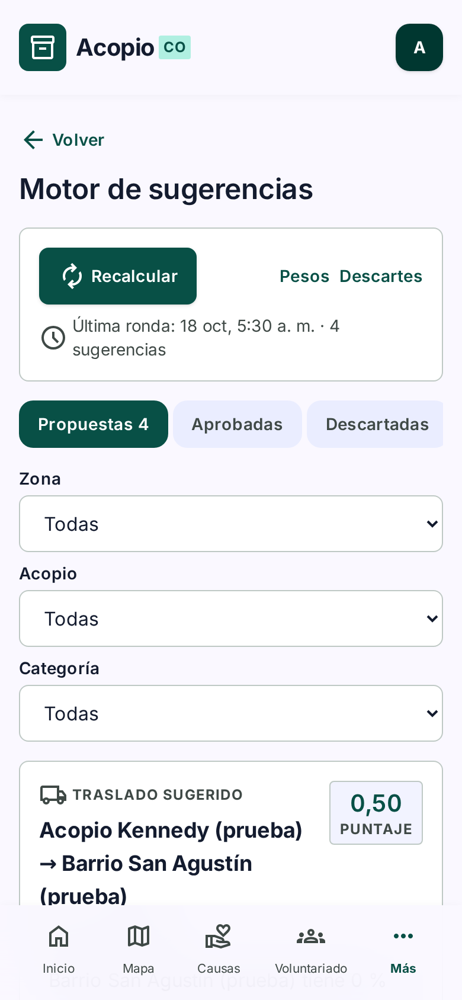

2. Un traslado aprobado se vuelve una **remisión** en borrador (C12). El Administrador la
   revisa y la despacha; entonces pasa a «En tránsito».

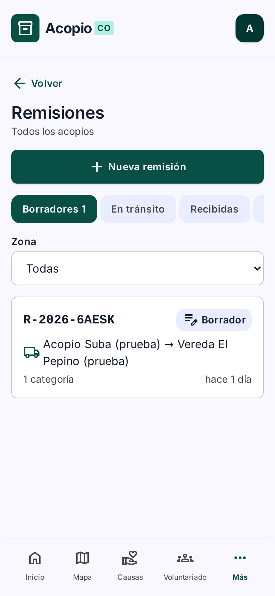

3. La remisión despachada tiene su **documento** para imprimir, con el código, el QR, las
   cantidades y los espacios para las firmas de quien entrega y quien recibe.

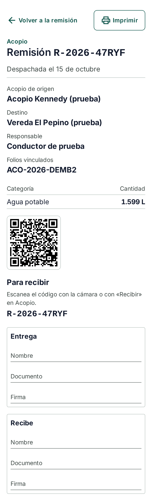

4. En la zona, el Receptor escanea el QR o escribe el código, confirma lo que llegó y adjunta
   una foto. La pantalla confirma la recepción y lleva a la ficha de la zona. Si el
   código no es de una remisión, responde «Ese código no es el QR de una remisión»; si la
   remisión ya se recibió, «Esta remisión ya no está en camino a tus zonas».

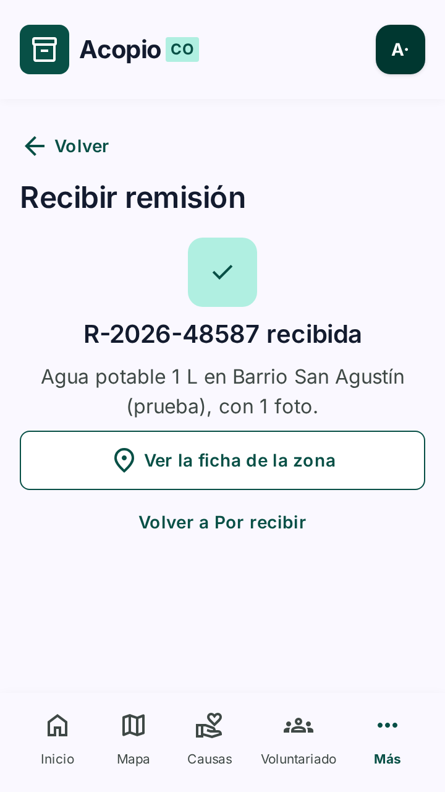

HU-13 Contar lo que la fórmula no ve se cubre desde «Mi zona»: el Receptor reporta una
necesidad que el cálculo no conoce, y el motor la toma en cuenta al recalcular.

### 1b. Flujo de las causas verificadas

Historias HU-02 Donar a una causa real y HU-15 No dirigir donantes a una estafa.

1. Cualquier persona, sin cuenta, abre **Causas** (P3). Solo aparecen causas de entidades
   verificadas, cada una con el sello y la fecha de verificación.

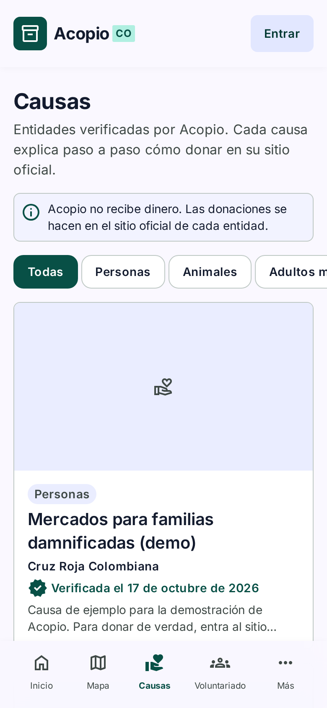

2. La **ficha de la causa** (P4) muestra la entidad, el paso a paso para donar y el enlace al
   sitio oficial.

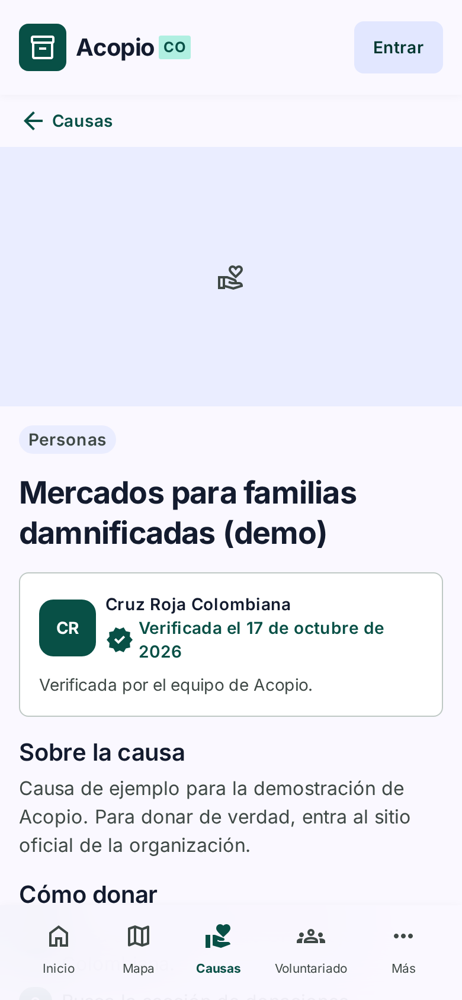

3. Al tocar «Ir al sitio oficial», una hoja avisa que la persona sale de Acopio y que Acopio
   no recibe dinero ni ve sus pagos. Solo después de confirmar se abre el sitio.

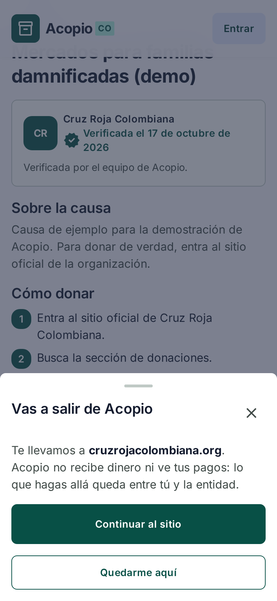

4. En la consola, el Administrador verifica la entidad (C15). El botón de verificar empieza
   inactivo hasta marcar la casilla del aviso de seguridad. Después publica la causa (C22),
   donde el formulario solo ofrece entidades verificadas. Si a una entidad se le quita la
   verificación, sus causas pasan a «atendidas» y la ficha pública pierde el sello y el
   enlace.

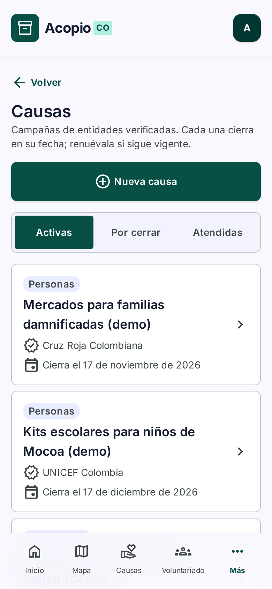

### 1c. Otras pantallas del incremento

El incremento tiene más pantallas que las de los dos flujos. Estas también leen la base de la
demo del servidor.

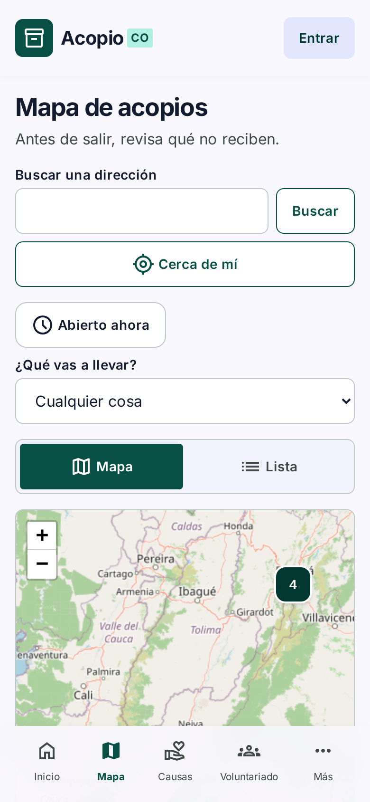

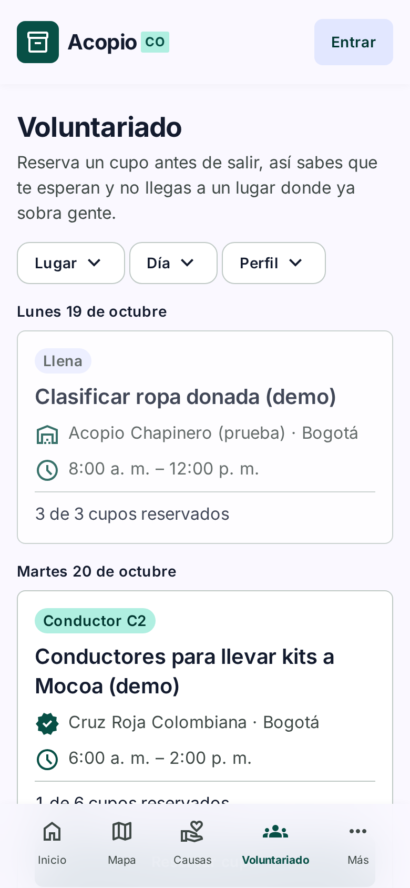

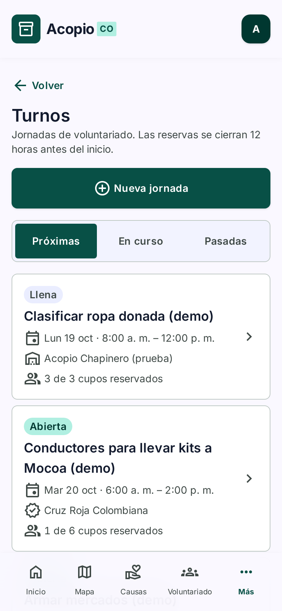

### 1d. Diagramas

Los diagramas están al día con el código del 18 de octubre. El de paquetes es el que pide la
sustentación; se dibuja a mano en `docs/02-arquitectura/diagramas/paquetes.html` y sus
dependencias salen de dependency-cruiser. Los de contenedores y los modelos de datos se
generan con Mermaid desde la misma carpeta.

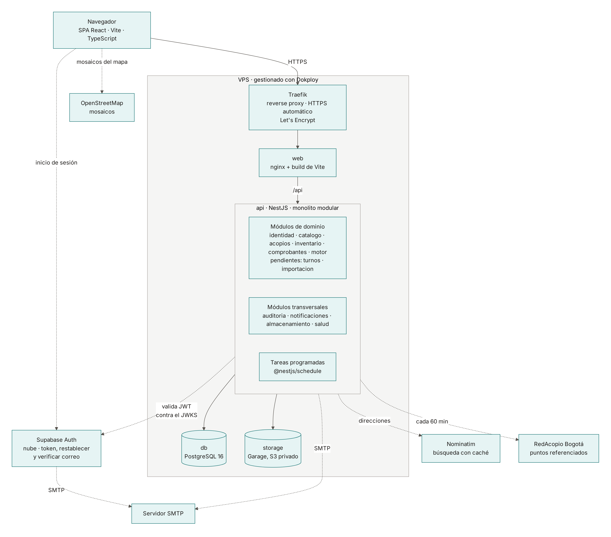

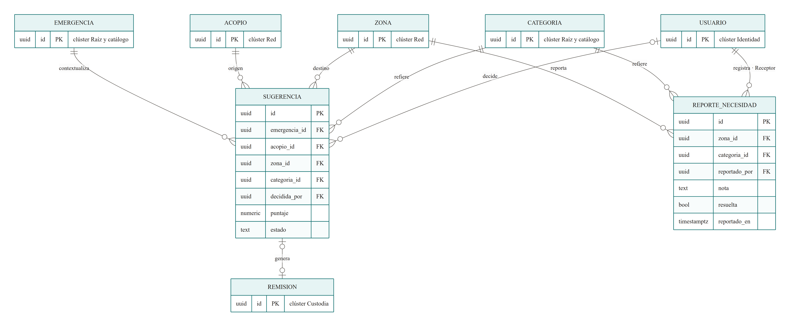

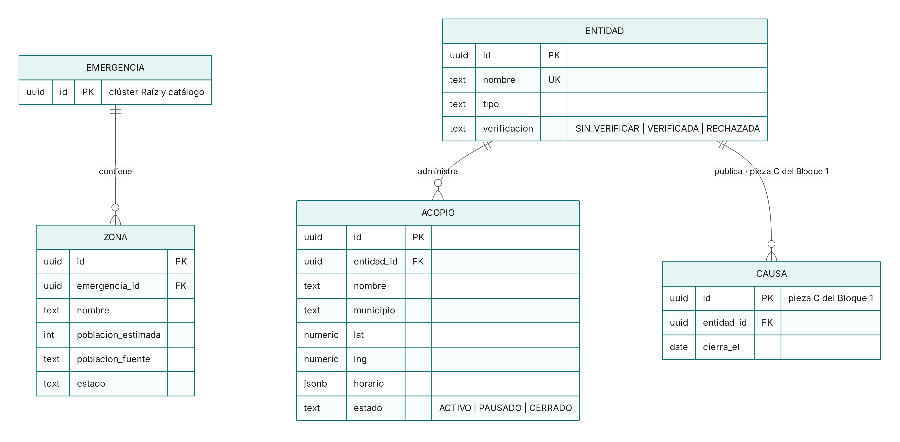

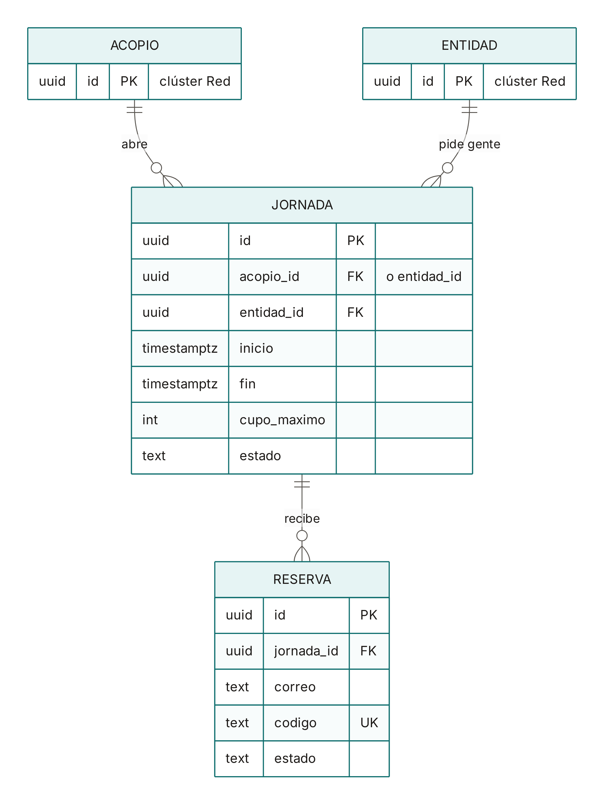

## 2. Patrones de diseño

Cada patrón tiene código que se puede abrir; las rutas son de `apps/api/src/` salvo que digan
otra cosa. El detalle de cada uno y cuándo se repite está en
[patrones y prácticas](../02-arquitectura/patrones-y-practicas.md).

### DAO

El acceso a datos pasa por DAO ([ADR-0019](../02-arquitectura/adr/ADR-0019-dao-sobre-prisma.md)).
Hay 20, en `modulos/<módulo>/dao/`: entre ellos `ComprobanteDao`, `MovimientoDao`,
`SaldoDao`, `RemisionDao`, `SugerenciaDao`, `CausaDao`, `JornadaDao` y `ReservaDao`. Los
servicios los usan y abren la transacción con `Transacciones.ejecutar`; los controladores no
los ven. Por dentro usan Prisma, pero en los siete módulos migrados (`inventario`,
`comprobantes`, `motor`, `salud`, `notificaciones`, `acopios` y `turnos`) ningún otro archivo
toca Prisma, y dependency-cruiser lo revisa en cada pull request.

- Beneficio: el servicio de recepción, por ejemplo, se lee como reglas de negocio (qué líneas
  se confirman, cuándo se rechaza) sin consultas en medio. Una consulta se cambia en un solo
  lugar.
- Complejidad: una capa más, y cada consulta nueva pide un método en el DAO. La transacción
  viaja como parámetro para que la bitácora quede en la misma.

### DTO

Sí aplica. Todos los DTO salen de `crearDto` (`comun/dto.ts`, sobre `createZodDto`), que
valida la entrada y además genera el contrato OpenAPI del que la web saca sus tipos:

- De entrada, en cada controlador: `CrearDonacionDto` lleva el acopio y las líneas
  (categoría, código de barras, cantidad, vencimiento) cuando el Donador prepara una
  donación; `RecibirDto` lleva lo que el Operador confirma de cada línea al recibir.
- De respuesta, en `comun/respuestas.ts` (62 clases): `ComprobanteDto` es lo que la web
  muestra de una donación.

Se diferencian de la entidad persistida en lo que dejan fuera y en la forma. `ComprobanteDto`
no trae el donador, las claves de la factura en Garage ni quién la verificó; trae el nombre
del acopio y de cada categoría en vez de sus identificadores, y `tieneFactura` en vez de la
clave. Los nombres van en camelCase y las cantidades como números, no como `Decimal`. Una
prueba (`comun/dto-nombres.test.ts`) falla si dos DTO comparten nombre, porque se pisarían en
el contrato.

### Creacionales

| Patrón | Dónde | Problema que resuelve | Beneficio | Complejidad |
|---|---|---|---|---|
| Factory Method | `fabricarProveedorIdentidad` en `modulos/identidad/proveedor/fabrica-proveedor.ts`, registrada con `useFactory` en `identidad.module.ts` | La API autentica con un proveedor local en desarrollo y con Supabase en producción. Quien inicia sesión o verifica un token no debe saber cuál | Cambiar de proveedor es cambiar `AUTH_PROVEEDOR`. Ningún servicio tiene un `if` por proveedor | Los dos adaptadores se construyen aunque se use uno. La elección vive en la configuración del módulo, lejos de quien la usa |
| Singleton | `ENTORNO` en `config/config.module.ts`, que lee y valida las variables una sola vez con `leerEntorno()`; `PrismaService`, una sola conexión con su pool para toda la API | Validar el entorno en cada uso sería lento, y abrir un cliente de base por servicio agotaría las conexiones | Una variable inválida detiene el arranque; todos comparten el mismo pool | Es el contenedor de Nest el que garantiza una sola instancia (alcance por defecto), no la clase. Un `new PrismaService()` a mano lo rompería |

### Estructurales

| Patrón | Dónde | Problema que resuelve | Beneficio | Complejidad |
|---|---|---|---|---|
| Adapter | `ProveedorLocal` y `ProveedorSupabase` frente al puerto `ProveedorIdentidad`; `AlmacenS3` y `AlmacenMemoria` frente a `Almacen`; el geocodificador de Nominatim | Supabase, el SDK de S3 y Nominatim tienen interfaces propias. El dominio necesita una sola, en español y con sus tipos | Las pruebas usan el almacén en memoria y el geocodificador falso, sin red. Cambiar de proveedor no toca el dominio | Una interfaz y un archivo por servicio externo, y el adaptador hay que mantenerlo cuando cambia el SDK |
| Proxy | `GeocodificacionService` en `modulos/acopios/geocodificacion.ts`, delante del geocodificador de Nominatim | El endpoint que convierte una dirección en coordenadas es público, y Nominatim permite una consulta por segundo | Caché de 24 horas, una cola con tope y una sola llamada para consultas iguales simultáneas. Quien geocodifica no sabe nada de eso | La caché vive en memoria: se pierde al reiniciar y no se comparte entre instancias de la API |
| Facade | `AlmacenamientoService` en `modulos/almacenamiento/` | Guardar la foto de una factura exige convertirla a WebP, hacer la miniatura, subir las dos, borrar la primera si falla la segunda y firmar URLs | `FacturasService` llama a `guardarImagen` y a `urlFirmada` y no sabe nada de sharp ni de S3 | Si alguien necesita algo que la fachada no ofrece, tiene que ampliarla en vez de ir al almacén directamente |

### De comportamiento

| Patrón | Dónde | Problema que resuelve | Beneficio | Complejidad |
|---|---|---|---|---|
| Chain of Responsibility | Los guards globales de `app.module.ts`: `OrigenGuard`, luego `LimiteIntentosGuard`, luego `AutenticacionGuard`. Después, el pipe de validación y el filtro de errores | Cada petición pasa por varias revisiones independientes: origen de las escrituras con cookie, límite de intentos, sesión y rol | Cada eslabón decide si deja pasar o corta con su error. Agregar una revisión es agregar un guard, sin tocar los demás | El orden importa y está en un solo arreglo. Un error en un eslabón corta la cadena y puede esconder lo que habrían dicho los siguientes |
| Strategy | El mismo puerto `ProveedorIdentidad` usado por `SesionService` e `InvitacionesService`, y `Almacen` usado por `AlmacenamientoService` | Iniciar sesión o guardar un archivo tiene dos algoritmos válidos según el ambiente | Quien usa la estrategia no cambia al cambiarla. Las pruebas de integración inyectan la de memoria | Se solapa con Adapter en las mismas clases: el adaptador traduce la interfaz y la estrategia es poder intercambiarlas |
| Observer | TanStack Query en la web (`apps/web/src/api/`): cada pantalla se suscribe a una consulta con un hook `useAlgo` | Varias pantallas muestran el mismo dato, por ejemplo los saldos de un acopio, y tienen que actualizarse juntas tras una salida | Al invalidar una consulta después de una escritura, todas las suscritas se vuelven a pintar | Hay que saber qué consultas invalidar después de cada escritura; si falta una, la pantalla muestra datos viejos |

## 3. Registro documental del Sprint

### 3a. Sprint Planning

El sprint va del 12 al 25 de octubre, con la Review en la validación de clase del viernes 23
([P-047](../01-requerimientos/pendientes.md)).

| Elemento | Descripción |
|---|---|
| Sprint Goal | El administrador decide cada traslado con el ranking del motor y lo despacha con una remisión que la zona confirma al recibir, y el portal muestra solo causas de entidades verificadas |
| Historias seleccionadas | Del Sprint 1, sin terminar: HU-10a Ver a dónde falta y de dónde sobra (8) y HU-10b Aprobar o descartar un traslado (5). Nuevas: HU-11 Despachar con un documento verificable (5), HU-12 Confirmar la llegada sin contar unidad por unidad (3) y HU-13 Contar lo que la fórmula no ve (3). Pendientes del Sprint 1: HU-02 Donar a una causa real (3) y HU-15 No dirigir donantes a una estafa (3). Suman 30 puntos. Los criterios de aceptación están en el [Avance 2](avance-02-requisitos.md#historias) |
| Tareas técnicas | DAO, DTO y patrones de diseño ([#59](https://github.com/Proyecto-IngSoftware/acopio/issues/59)). API de la etapa 2 del motor y simulador ([#46](https://github.com/Proyecto-IngSoftware/acopio/issues/46)). Contrato OpenAPI sin arreglos en los nullable ([#38](https://github.com/Proyecto-IngSoftware/acopio/issues/38)). Maquetas en Stitch de C10, C11 y las pantallas de remisión y recepción. Interfaz del motor en tres ciclos ([#35](https://github.com/Proyecto-IngSoftware/acopio/issues/35)). Pieza C del Bloque 1: verificación de entidades y causas ([#48](https://github.com/Proyecto-IngSoftware/acopio/issues/48)). Servidor de pruebas ([#26](https://github.com/Proyecto-IngSoftware/acopio/issues/26)) |
| Responsables iniciales | Según los roles del Sprint 0 ([Avance 1, §5](avance-01-sprint0.md#5-roles-iniciales-y-acuerdos-de-trabajo)): Joseph, arquitectura, modelo de datos e integración; Brayan, requerimientos y diseño UI/UX; Alejandra, coordinación del sprint y documentación; Michael, calidad, pruebas y despliegue. El responsable hace el seguimiento de su área; la programación se reparte entre los cuatro. Detalle por tarea en la tabla de abajo |
| Dependencias o riesgos | La interfaz del motor depende de la API de la etapa 2 y de las maquetas aprobadas. El servidor de pruebas depende de decidir proveedor, dominio y remitente antes del 18 de octubre. Microsoft 365 retira el SMTP con contraseña a fines de 2026 (RTA-04) |
| Definition of Done | La misma del Sprint 1 ([Avance 4](avance-04-sprint1.md#3a-sprint-planning)), con un punto más: el cambio entra por un pull request con el CI en verde, que Joseph revisa y fusiona ([P-051](../01-requerimientos/pendientes.md)) |

Cada tarea queda con quien tiene ese rol desde el Sprint 0. Una tarea con responsable no es
de una sola persona: el responsable garantiza que avance y quede documentada.

| Tarea | Responsable | Rol del Sprint 0 | Apoyo |
|---|---|---|---|
| Validar los criterios de aceptación de las siete historias antes de construir | Brayan | Análisis de requerimientos | Alejandra los deja en el tablero |
| Maquetas en Stitch de C10, C11, remisión, recepción y P3 y P4 (causas) | Brayan | Diseño UI/UX | Joseph las aprueba antes de escribir código |
| Modelo de datos y migraciones de la pieza C ([#48](https://github.com/Proyecto-IngSoftware/acopio/issues/48)) | Joseph | Arquitectura y modelo de datos | |
| API de la etapa 2 del motor y simulador ([#46](https://github.com/Proyecto-IngSoftware/acopio/issues/46)) | Joseph | Arquitectura e integración | Michael, pruebas de integración |
| Contrato OpenAPI sin arreglos en los nullable ([#38](https://github.com/Proyecto-IngSoftware/acopio/issues/38)) | Joseph | Integración entre la web y la API | Michael revisa |
| Interfaz del motor en tres ciclos ([#35](https://github.com/Proyecto-IngSoftware/acopio/issues/35)) | Joseph | Liderazgo de integración | Brayan, maquetas; Michael, recorridos |
| API e interfaz de la pieza C ([#48](https://github.com/Proyecto-IngSoftware/acopio/issues/48)) | Se reparte en el Planning | Desarrollo compartido | |
| Pruebas y recorridos de punta a punta del motor y de la pieza C | Michael | Pruebas | |
| Revisión de los pull requests | Michael | Revisión de calidad | Todos revisan al menos uno |
| Servidor de pruebas, contenedores y runbook ([#26](https://github.com/Proyecto-IngSoftware/acopio/issues/26)) | Michael | Despliegue | Joseph, decisión de proveedor y dominio |
| Planning, seguimientos semanales, tablero y cierre del sprint ([#47](https://github.com/Proyecto-IngSoftware/acopio/issues/47)) | Alejandra | Coordinación de Sprint | |
| Registro del sprint, «Cambios al construir», pendientes, ADR nuevos y Word del avance | Alejandra | Documentación | Joseph genera el Word |

Los roles no rotan en el Sprint 2: el equipo decidió el 2026-10-07 seguir con los del Sprint 0
([P-048](../01-requerimientos/pendientes.md)).

### 3b. Seguimiento del equipo (Daily Scrum)

Seguimiento del domingo 18 de octubre, desde el seguimiento del Sprint 1 del 9 de octubre.
Solo quedó registrado el avance de Joseph.

| Integrante | ¿Qué terminé desde el último seguimiento? | ¿Qué haré a continuación? | ¿Qué bloqueo o ayuda necesito? |
|---|---|---|---|
| Joseph | La interfaz del motor en sus tres ciclos y «Mi zona» (Bloque 4 cerrado); el servidor de pruebas en Dokploy con la demo; la pieza C, con la verificación de entidades y las causas (HU-02 y HU-15); el Bloque 5 de turnos, que no estaba en el Planning (HU-03); la revisión de cada bloque contra sus criterios en el servidor | El Word del Avance 5 y la sustentación del 23; la ronda de pruebas del equipo en el servidor (#58); la pieza E, el importador de RedAcopio (#49) | Que el resto del equipo haga la ronda de pruebas por rol y revise pull requests |
| Brayan | Sin registro en este seguimiento | | |
| Alejandra | Sin registro en este seguimiento | | |
| Michael | Sin registro en este seguimiento | | |

### 3c. Sprint Review y retrospectiva

La revisión se hace en la validación de clase del viernes 23 de octubre, sobre el servidor de
pruebas. La evidencia son las capturas de la §1, los contenedores en ejecución y los
recorridos de punta a punta con Playwright, que recorren cada flujo en un navegador real y
comprueban el efecto en la API.

| Recorrido | Qué comprueba | Resultado en el servidor |
|---|---|---|
| `consola-motor.mjs` | Recalcular, aprobar, descartar y ajustar los pesos del motor | 9 de 9, el 17 de octubre |
| `consola-remisiones.mjs` | Despachar una remisión y ver su documento | 7 de 7, el 17 de octubre |
| `consola-recepciones.mjs` | Recibir una remisión en la zona con foto, entrando por «Mi zona» | 7 de 7, el 17 de octubre |
| `portal-causas.mjs` | Directorio, aviso de salida y causas atendidas | 4 de 4, el 18 de octubre |
| `consola-causas.mjs` | Verificar una entidad, publicar, renovar, archivar y quitar la verificación | 6 de 6, el 18 de octubre |

El detalle de cada corrida está en `docs/06-operacion/recorridos.md`.

| Historia | ¿Se cumplió? | Criterios pendientes, ajustes u observaciones |
|---|---|---|
| HU-10a Ver a dónde falta y de dónde sobra | Sí | |
| HU-10b Aprobar o descartar un traslado | Sí | |
| HU-11 Despachar con un documento verificable | Sí | |
| HU-12 Confirmar la llegada sin contar unidad por unidad | Sí | |
| HU-13 Contar lo que la fórmula no ve | Sí | |
| HU-02 Donar a una causa real | Sí | Revisada en el servidor el 18 de octubre |
| HU-15 No dirigir donantes a una estafa | Sí | Revisada en el servidor el 18 de octubre. La revisión diaria que archiva las causas vencidas se comprueba con una prueba de integración |

Fuera del Planning también se construyó el Bloque 5, turnos de voluntariado (HU-03), con sus
criterios revisados en el servidor el 18 de octubre.

#### Retrospectiva

**¿Qué funcionó bien?**

Pendiente: la escribe Joseph.

**¿Qué no funcionó o dificultó el trabajo?**

Pendiente: la escribe Joseph.

**¿Qué aprendimos?**

Pendiente: la escribe Joseph.

**¿Qué acción concreta aplicaremos en el siguiente corte?**

Pendiente: la escribe Joseph. Tiene que ser una acción verificable.

## 4. Repositorio y servidor

- Repositorio público: <https://github.com/Proyecto-IngSoftware/acopio>
- Servidor de pruebas con la demo: <https://acopio.josephqaz.dev>
