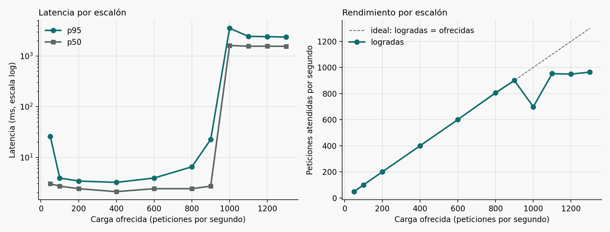
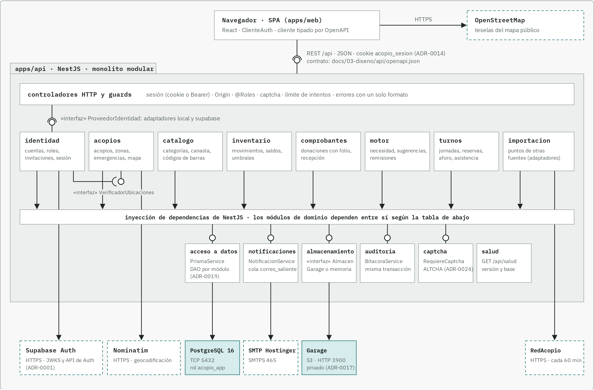
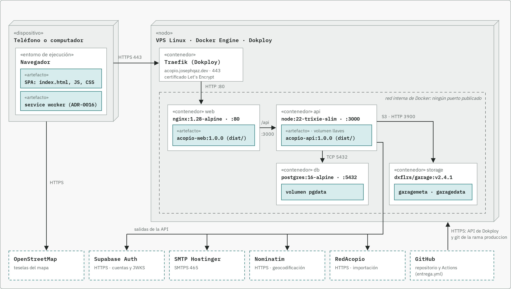

# Avance 6 · Sprint 3: pruebas, entrega y despliegue

La consigna es la [guía del Sprint 3](../guias/Avance%20de%20Proyecto%20Sprint%203%20–%20IS1.pdf).
Pide cinco cosas: un incremento con versión, pruebas conectadas con un flujo de integración y
entrega, el registro del sprint, una vista de componentes con el ADR-003 y un diagrama de
despliegue de la versión entregada. La sustentación es el viernes 4 de diciembre. Esta nota es
la fuente del Word: lo que va desde «## 1. Incremento funcional» lo vuelca
[generar-avance-06.py](generar-avance-06.py), y lo de antes es el tablero de trabajo.

## Lo que falta

Cada punto dice quién lo hace y dónde queda.

- **Joseph:** configurar el environment `produccion` en GitHub y la rama `produccion` en
  Dokploy ([despliegue](../../06-operacion/despliegue.md#entrega-de-una-versión)), crear la
  etiqueta `v1.0.0`, aprobar el despliegue y guardar la captura del run de `entrega.yml` en
  `evidencia/entrega.png`.
- **Joseph y el equipo:** reunión de seguimiento antes del 4 de diciembre. Se llena la tabla de
  3b con lo que diga cada uno y se guarda la captura en `evidencia/seguimiento.png`. En la misma
  reunión se ajusta la retrospectiva.
- **Joseph:** prueba de usabilidad con 3 a 5 personas según el
  [guion](usabilidad/guion-de-usabilidad.md), con las respuestas en
  [registro.csv](usabilidad/registro.csv). Claude calcula el SUS y completa la tabla de 2b.
- **Joseph:** captura del tablero del Project con la vista del Sprint 3 en
  `evidencia/tablero.png`, y capturas de la versión 1.0.0 en el servidor para la Review.
- Al final, `generar-avance-06.py`, `unificar-avances.py` y subir el Word a OneDrive.

## Qué pide la guía y dónde está

| Pide | Estado | Dónde |
|---|:-:|---|
| 1. Incremento ligado a historias, con lo terminado, lo parcial y lo pendiente | ✅ | §1 |
| 1. Versión o etiqueta del repositorio | 🟡 | `v1.0.0` en `package.json` y `/api/salud`; falta crear la etiqueta |
| 2a. Suite unitaria: 5 escenarios con caso válido, rechazado y de frontera | ✅ | §2a, tabla de escenarios |
| 2a. Dos o más pruebas de integración | ✅ | §2a |
| 2a. Recorrido completo de una funcionalidad | ✅ | §2a, recorridos de Playwright |
| 2b. Rendimiento con prueba de carga y gráfico del codo | ✅ | §2b, `evidencia/carga/` |
| 2b. Seguridad o fiabilidad | ✅ | §2b, `evidencia/restauracion/` |
| 2b. Usabilidad con usuarios reales | ❌ | §2b; pendiente la sesión con personas |
| 2c. CI/CD con verificación, evidencia, versión, despliegue manual y comprobación | 🟡 | §2c; falta el primer run de `entrega.yml` |
| 3a. Sprint Planning con captura del tablero | 🟡 | §3a; falta la captura |
| 3b. Daily Scrum con evidencia | ❌ | §3b; pendiente la reunión |
| 3c. Review y retrospectiva | 🟡 | §3c; falta validar en la reunión |
| 4. Vista de componentes y conectores con ADR-003 | ✅ | §4, ADR-0026 |
| 5. Despliegue y diagrama | 🟡 | §5; la versión desplegada se confirma con el run de entrega |

## 1. Incremento funcional

El Sprint 3 fue del 26 de octubre al 22 de noviembre de 2026, y el cierre de la entrega va hasta
el 4 de diciembre. El incremento no agrega pantallas: cierra lo que quedó parcial, endurece lo
que ya estaba construido y deja una versión que se puede verificar y desplegar de forma
reproducible. Es la versión **1.0.0**, la de `apps/api/package.json` y `apps/web/package.json`,
y la API la informa en `GET /api/salud` (`{"estado":"ok","base":"ok","version":"1.0.0"}`).

Pendiente: crear la etiqueta v1.0.0 sobre el commit cca65b6 de main y aprobar su despliegue.

### 1a. Qué entró en el sprint

| Cambio | Pull request | Historia o requisito | Estado |
|---|---|---|:-:|
| Captcha con ALTCHA en el registro del Donador y en las reservas sin cuenta, con reto PBKDF2 y prueba de un solo uso (ADR-0024) | #189, #190 | HU-07 (registro del Donador), reservas de voluntariado | Terminado |
| Cola de correo segura con varias instancias de la API | #189 | Notificaciones de HU-08 y de las reservas | Terminado |
| Rendimiento: saldos del historial por bloques (ADR-0025), índices y tareas concurrentes protegidas | #192 | HU-05 y el objetivo de 200 ms en saldos | Terminado |
| Purga del correo de reservas y preparación del SMTP de Hostinger | #193 | P-091 | Terminado |
| La cola sin conexión se aísla por usuario y los recordatorios se rearman | #194 | HU-04 (captura sin conexión) | Terminado |
| Versión en `/api/salud`, reportes de pruebas en el CI y workflow de entrega con aprobación | #197 | Guía del Sprint 3, §2c | Terminado |
| Vista de componentes, diagrama de despliegue y ADR-0026 | este avance | Guía del Sprint 3, §4 y §5 | Terminado |
| Prueba de carga escalonada y restauración del respaldo | este avance | RNF de rendimiento y fiabilidad (#25, P-090) | Terminado |
| Lo que queda de RF-RED-011: aviso al Administrador cuando una lectura aborta, ocultar y convertir referenciados, CSV de referenciados | ninguno | P-076 | Pendiente |
| Pantalla para editar presentaciones en C18 | ninguno | P-085 | Pendiente |

### 1b. Validaciones y manejo de errores

Cada entrada de la API se valida con un esquema Zod en su DTO, y todos los errores salen con el
mismo formato (`estado`, `codigo`, `mensaje`). Las dos piezas nuevas del sprint siguen esa regla:

- Un registro de Donador sin prueba de captcha responde `400 CAPTCHA_INVALIDO`, y una prueba ya
  usada también se rechaza (`captcha.int.test.ts`).
- El sexto intento de inicio de sesión en un minuto desde la misma IP responde 429
  (`autenticacion.int.test.ts`).
- `/api/salud` responde 503 si la base no contesta; el Dockerfile lo usa como healthcheck y el
  workflow de entrega lo usa para confirmar la versión.

## 2. Pruebas de software

### 2a. Pruebas funcionales

Todas las suites corren en cada pull request y en cada push a `main`. El último run de `main`,
después de fusionar la versión 1.0.0, dejó sus reportes JUnit como artifact
([run 45965859422](https://github.com/Proyecto-IngSoftware/acopio/actions/runs/45965859422)):

| Suite | Herramienta | Pruebas | Fallas |
|---|---|--:|--:|
| Unitarias de la API | Jest | 104 | 0 |
| Unitarias de `packages/shared` (fórmulas del motor, inventario, turnos) | Jest | 116 | 0 |
| Unitarias de la web, con axe en 62 archivos | Vitest | 1258 | 0 |
| Integración de la API contra PostgreSQL 16 | Jest y Supertest | 567 | 0 |

**Suite unitaria: cinco escenarios.** Cada escenario tiene al menos un caso válido, uno rechazado
y uno de frontera o de transición de estado. Los nombres son los de las pruebas en el código.

| Escenario | Archivo | Caso válido | Caso rechazado | Frontera o transición | Resultado |
|---|---|---|---|---|---|
| Cantidad de una línea de donación o de conteo | `apps/api/src/comun/validacion/cantidades.test.ts` | «admite hasta 10.000» | «rechaza lo que pasa de 10.000», «rechaza cero» | «admite cero y 10.000» en el conteo físico | Pasa |
| Contraseña al activar una invitación | `apps/api/src/modulos/identidad/invitaciones/politica-contrasena.test.ts` | «acepta una frase larga sin símbolos» | «rechaza repeticiones y secuencias», «rechaza que contenga el usuario» | «rechaza menos de 12 caracteres» | Pasa |
| Plan de una remisión del motor | `apps/api/src/modulos/motor/plan-remision.test.ts` | «suma dos veces la misma categoría y ordena por categoría» | «rechaza una línea que supera el movible y dice cuánto cabe», «no acepta cantidades en cero o negativas» | «una categoría sin movible tiene máximo 0», «suma con tres decimales» | Pasa |
| Semáforo del inventario | `packages/shared/src/inventario.test.ts` | «en rango es EN_RANGO, incluido el máximo» | «sin umbral no hay semáforo» | «desde el mínimo hasta 25 % por encima es CERCA», «con mínimo 0, cero es CERCA» | 13 de 13 |
| Cola de entradas sin conexión | `apps/web/src/sin-conexion/cola.test.ts` | «envía en orden, de a una, y borra cada entrada solo cuando la API la confirma» | «sin la asignación (403) la entrada queda rechazada y no se reintenta» | «corregir la fecha devuelve la entrada a la cola, de última», «dos envíos seguidos no mandan dos veces lo mismo» | 15 de 15 |

Las tres suites de la API dieron 18 de 18 corridas juntas el 27 de noviembre.

**Integración.** Cinco suites contra un PostgreSQL 16 real, corridas el 27 de noviembre: 77 de
77.

| Suite | Qué conecta | Ejemplo |
|---|---|---|
| `recepcion.int.test.ts` | API, base y bitácora | «se recibe donde llegó aunque se preparara para otro acopio, destacado en la bitácora» |
| `movimientos.int.test.ts` | API y base, con el disparador del saldo | «más que el saldo: 409 con el saldo disponible, y no cambia nada» |
| `autenticacion.int.test.ts` | API, guard global y límite de intentos | «el sexto intento de sesión en un minuto recibe 429» |
| `concurrencia.int.test.ts` | Transacciones simultáneas sobre el mismo saldo | «20 salidas simultáneas de 1 sobre un saldo de 12: pasan 12 y el saldo queda en 0» |
| `salud.int.test.ts` | API, base y `package.json` | `/api/salud` responde la versión de la API |

**Recorrido completo.** Dos scripts de Playwright en Chromium a 360 × 640, contra el Compose con
la API 1.0.0, el 27 de noviembre. En cada pantalla revisan que axe no marque violaciones graves,
que no haya scroll horizontal ni errores de JavaScript.

| Recorrido | Qué hace | Resultado |
|---|---|---|
| `validacion-general.mjs` | Entra con cada rol, visita sus pantallas, comprueba los accesos negados, invita y activa una cuenta, registra una salida y un conteo, y revisa la bitácora | 57 de 57 pasos, 0 respuestas 5xx |
| `donador.mjs` | El Donador entra, prepara una donación con foto, obtiene el folio, la sigue y la cancela | 7 de 7 pasos |

La salida de los dos está en `evidencia/recorridos/`.

### 2b. Pruebas no funcionales

**Rendimiento: carga escalonada y gráfico del codo.**

| Elemento | Contenido |
|---|---|
| Atributo y riesgo | Rendimiento. Durante una emergencia, el portal público y los saldos reciben picos de lectura. El riesgo es que la API deje de responder a tiempo y que nadie sepa con cuánta carga pasa. |
| Condiciones | Compose local con la versión 1.0.0 (API, PostgreSQL 16 y Garage en Docker), en un equipo de 12 núcleos y 15 GB, con k6 en el mismo equipo. Modo de lecturas: portada, necesidades, acopios, zonas, saldos e historial, intercalados. Datos de la demo. |
| Procedimiento | `scripts/carga-acopio.mjs` con k6 2.4.0 en 11 escalones de 50 a 1300 peticiones por segundo, cada uno con 5 s de subida y 25 s de meseta. Las peticiones se reparten entre 5000 clientes simulados para no chocar con el límite de 300 por minuto por IP y ruta. `scripts/codo-carga.py` calcula cada meseta. |
| Resultado | Hasta 900 peticiones por segundo la API atiende todo lo ofrecido, con p50 de 2 a 3 ms y p95 de 3 a 23 ms. Desde 1000 por segundo el rendimiento se queda cerca de 950, el p50 sube a 1,6 s, el p95 a 2,4 s y k6 no alcanza a lanzar parte de las iteraciones. Ninguna petición falló. La CPU de la API llegó a cerca de 120 %: el cuello es el proceso de Node. El codo está entre 900 y 1000 peticiones por segundo, muy por encima del objetivo de 200 ms en saldos. |
| Evidencia | `evidencia/carga/codo.png`, `codo.csv`, el resumen de k6 y el muestreo de CPU. Una primera corrida con 8 escalones dio el mismo codo (`codo-primera-corrida.csv`). |

El p95 de 26 ms del primer escalón es el arranque en frío de la API después de una pausa.

**Fiabilidad: restaurar la base desde un respaldo.**

| Elemento | Contenido |
|---|---|
| Atributo y riesgo | Recuperación. Si se pierde el volumen de PostgreSQL, el inventario y la bitácora de custodia se pierden con él. El riesgo es tener respaldos que nunca se probaron. |
| Condiciones | Base del Compose local con los datos de la demo: 140 movimientos, 724 filas de bitácora, 27 usuarios, 22 migraciones y 6 disparadores. Restauración en un PostgreSQL 16 nuevo y vacío. |
| Procedimiento | `pg_dump` en texto plano, como dice [Respaldos](../../06-operacion/despliegue.md#respaldos). Restauración con `psql -v ON_ERROR_STOP=1`, para que cualquier error detenga el proceso. Antes y después se corre la misma consulta, y con el rol `acopio_app` se prueba que la bitácora sigue siendo solo de inserción. |
| Resultado | El respaldo tomó 0,35 s (915 KB) y la restauración 0,89 s, sin errores. Las seis cifras coinciden, incluido el saldo de un acopio conocido (4000 unidades). `acopio_app` recibió `permission denied` al intentar un `UPDATE` sobre la bitácora y pudo insertar. |
| Evidencia | `evidencia/restauracion/`: la consulta, las cifras antes y después y la prueba de permisos. |

**Seguridad: límite de intentos por cliente.** La misma prueba de carga sirvió de control. A 120
peticiones por segundo desde una sola IP, 902 de 2703 respondieron 429. Repartidas entre 1000
clientes, ninguna. La prueba de integración `autenticacion.int.test.ts` cubre el caso del inicio
de sesión: el sexto intento en un minuto recibe 429.

**Usabilidad con personas.**

| Elemento | Contenido |
|---|---|
| Atributo y riesgo | Usabilidad del portal y del flujo del Donador. Riesgo: que alguien que quiere ayudar no encuentre qué se necesita o abandone la donación. |
| Condiciones | Servidor de pruebas, teléfono de cada persona, datos de la demo. De 3 a 5 personas que no conocen Acopio. |
| Procedimiento | Cuatro tareas sin ayuda (encontrar una necesidad, preparar una donación, seguirla y reservar un turno) y el cuestionario SUS. [Guion](usabilidad/guion-de-usabilidad.md). |
| Resultado | Pendiente. |
| Evidencia | `usabilidad/registro.csv` y la foto o captura de una sesión. |

Pendiente: correr la prueba de usabilidad con personas y completar el resultado con el SUS.

### 2c. Flujo de CI/CD

Dos workflows en `.github/workflows/`:

- `ci.yml` corre en cada pull request y en cada push a `main`.
- `entrega.yml` corre cuando se crea una etiqueta `vX.Y.Z`, o a mano sobre una etiqueta para
  volver a una versión anterior.

| Pide la guía | Cómo lo hace |
|---|---|
| Activarse con cambios del repositorio | `pull_request` y `push` a `main` en `ci.yml`; `push` de una etiqueta `v*` en `entrega.yml` |
| Obtener el código | `actions/checkout` |
| Preparar herramientas y dependencias | Bun 1.3.11, Node 22 desde `.nvmrc` y `bun install --frozen-lockfile` |
| Preparar los servicios de prueba | PostgreSQL 16 como `service` del job, con healthcheck |
| Ejecutar la suite | lint, tipos, límites entre módulos, colores, unitarias e integración |
| Informar fallo | Cualquier paso en rojo deja el check en rojo y bloquea la fusión |
| Conservar evidencia | Los JUnit de las cuatro suites como artifact por 90 días, también cuando una falla |
| Identificar el entregable | La etiqueta tiene que coincidir con la versión de `apps/api/package.json`; si no, el run falla |
| Construirlo de forma reproducible | `docker build` de `acopio-api:<versión>` y `acopio-web:<versión>` desde el commit, con `bun.lock` congelado |
| Despliegue con etapa manual | El job `desplegar` usa el environment `produccion`, que pide la aprobación de Joseph. Al aprobar, mueve la rama `produccion` al commit verificado y le pide el despliegue a Dokploy |
| Comprobación posterior | El job `comprobar` consulta `/api/salud` hasta que responda la versión de la etiqueta, y después carga la portada |

La versión verificada y la desplegada se relacionan así: etiqueta, commit, versión de
`package.json` y campo `version` de `/api/salud`. Los pasos manuales y la vuelta atrás están en
[despliegue](../../06-operacion/despliegue.md#entrega-de-una-versión).

## 3. Registro documental del Sprint 3

### 3a. Sprint Planning

La Planning del Sprint 3, prevista para el 2 de noviembre, no se hizo como reunión. Este registro
la reconstruye a partir de los issues y los pull requests del sprint, y se valida en la reunión
de seguimiento.

| Elemento | Descripción |
|---|---|
| Sprint Goal | Entregar una versión 1.0.0 de Acopio verificada y desplegada: con las historias parciales cerradas, el registro y las reservas protegidos de bots, los saldos por debajo de 200 ms y la evidencia de calidad que pide el curso. |
| Historias seleccionadas | HU-05 Ver qué sobra y qué falta (criterio 2: dato atenuado después de 6 horas). HU-07 Preparar una donación que pueda demostrar (registro del Donador con captcha). HU-04 Registrar sin frenar la fila (cola sin conexión aislada por usuario). HU-01 Saber qué comprar antes de salir (criterio 2: ficha del punto de RedAcopio). |
| Tareas técnicas | Captcha con ALTCHA (#189, #190). Rendimiento de saldos e historial (#192). Purga del correo y SMTP de Hostinger (#193). Cola sin conexión y recordatorios (#194). Versión, reportes y workflow de entrega (#197). Prueba de carga y restauración. Vista de componentes, diagrama de despliegue y ADR-0026. |
| Responsables iniciales | Según el reparto de roles: Joseph, arquitectura y código; Brayan, requisitos y revisión de la interfaz; Alejandra, coordinación y documento; Michael, pruebas y despliegue. En la práctica, Joseph hizo el código y las pruebas del sprint. |
| Dependencias o riesgos | El servidor de pruebas depende del VPS y de Dokploy (#26). El correo depende de las credenciales de Hostinger. La prueba de carga no puede correr contra el servidor de la demo (P-090). La prueba de usabilidad depende de conseguir personas antes del 4 de diciembre. |
| Definition of Done | La del Sprint 2, con dos puntos más: el cambio queda en una versión etiquetada y se comprueba en el servidor después de desplegarlo. |

### 3b. Daily Scrum

La reunión de seguimiento del Sprint 3 se hace antes del 4 de diciembre. La evidencia es la
captura de la videollamada o una foto de la reunión.

| Integrante | ¿Qué terminé desde el último seguimiento? | ¿Qué haré a continuación? | ¿Qué bloqueo o ayuda necesito? |
|---|---|---|---|
| Joseph | Pendiente: se llena en la reunión | | |
| Brayan | Pendiente: se llena en la reunión | | |
| Alejandra | Pendiente: se llena en la reunión | | |
| Michael | Pendiente: se llena en la reunión | | |

### 3c. Sprint Review y retrospectiva

La Review se hace contra la versión 1.0.0. Hasta que esté desplegada, la evidencia viene del
Compose con la misma versión y de los recorridos de §2a.

| Historia | ¿Se cumplió? | Criterios pendientes, ajustes u observaciones |
|---|---|---|
| HU-05 Ver qué sobra y qué falta | Sí | El criterio 2 quedó terminado: pasadas 6 horas sin movimientos la fila avisa «puede no estar al día» con ícono y texto (`Inventario.test.tsx`). El cambio entró el 20 de octubre y no se había revisado en el Sprint 2 |
| HU-07 Preparar una donación que pueda demostrar | Sí | Los tres criterios siguen cumplidos, ahora con captcha en el registro del Donador. `donador.mjs` pasó 7 de 7 |
| HU-04 Registrar sin frenar la fila | Sí | La cola sin conexión ya no envía entradas de otro usuario del mismo teléfono (`cola.test.ts`) |
| HU-01 Saber qué comprar antes de salir | Sí | El criterio 2 se cumple con el importador de RedAcopio: la ficha muestra la fuente, su enlace y su antigüedad. Quedan cuatro casillas de RF-RED-011 que no son de esta historia (P-076) |

Pendiente: capturas de la versión 1.0.0 en el servidor para la Review.

#### Retrospectiva

Borrador: se ajusta con lo que diga el equipo en la reunión.

**¿Qué funcionó bien?** Las pruebas automáticas sostuvieron el sprint. Con más de 2000 pruebas
corriendo en cada pull request, cambios de fondo como los saldos por bloques o la cola de correo
con varias instancias entraron sin romper lo que ya funcionaba. Medir antes de afirmar también
sirvió: la calibración de la prueba de carga mostró que el límite por IP cortaba la curva, y
eso se corrigió antes de sacar conclusiones.

**¿Qué dificultó el desarrollo, las pruebas o la entrega?** La Planning y la Review del sprint
no se hicieron a tiempo, y el registro hubo que reconstruirlo al final. Durante casi todo el
semestre el despliegue dependió de que alguien entrara al panel de Dokploy, sin una versión que
dijera qué estaba corriendo. Y la prueba con usuarios reales quedó para la última semana.

**¿Qué aprendimos?** Que una versión visible desde afuera (`/api/salud`) vuelve comprobable el
despliegue, y que un respaldo solo cuenta cuando se ha restaurado alguna vez. También que el
trabajo de un sprint necesita su registro al mismo tiempo que se hace.

**¿Qué acción concreta aplicaremos en futuros proyectos?** Etiquetar una versión y desplegarla
con el mismo workflow desde el primer sprint, y agendar la Planning, el seguimiento y la Review
como eventos con fecha el día que empieza cada sprint.

## 4. Vista de componentes y conectores

La vista representa la versión 1.0.0. Muestra los componentes de la API, sus conectores, las
interfaces que ofrecen y las que requieren, la dirección de las dependencias y los sistemas
externos. La fuente es
[componentes-y-despliegue.html](../../02-arquitectura/diagramas/componentes-y-despliegue.html).

### ADR-003 · Los componentes colaboran por interfaces inyectadas

Es el [ADR-0026](../../02-arquitectura/adr/ADR-0026-componentes-por-interfaces-inyectadas.md)
del repositorio, porque los números 0001 a 0025 ya estaban usados.

| Elemento | Contenido |
|---|---|
| Título y estado | Los componentes colaboran por interfaces inyectadas. Aceptada, vigente en la versión 1.0.0. |
| Contexto | La API depende de servicios que el equipo no controla: Supabase Auth, el SMTP de Hostinger, Nominatim, RedAcopio y Garage. Las pruebas de integración corren en CI sin salir a Internet. Hay dos formas de autenticar (local en desarrollo, Supabase en el servidor) con la misma regla. `identidad` necesita validar ubicaciones, pero `acopios` ya depende de `identidad`. |
| Decisión | Cada colaboración que cruza un límite pasa por una interfaz con nombre y un token de inyección de NestJS: `ProveedorIdentidad`, `Almacen`, `Geocodificador`, `FuenteAcopios` y `VerificadorUbicaciones`. La web habla con la API por REST con el contrato OpenAPI. Ningún módulo de dominio importa el SDK de un servicio externo, y `dependency-cruiser` rechaza en CI los imports fuera de la tabla permitida. |
| Alternativa considerada | Llamar al SDK o a la URL del servicio desde el servicio que lo necesita y cambiar de entorno con condicionales. También se descartó partir las integraciones en microservicios, por el tamaño del equipo y del servidor (ADR-0008). |
| Justificación | Las pruebas reemplazan los adaptadores reales por falsos (`apps/api/test/app-prueba.ts`) y corren contra PostgreSQL real sin red. Cambiar de proveedor de identidad es cambiar `AUTH_PROVEEDOR` (P-025). La inversión con `VerificadorUbicaciones` mantiene los módulos sin ciclos (RNF-13). |
| Consecuencias | A favor: un proveedor se cambia en un adaptador, las pruebas no dependen de la red y la dirección de las dependencias la verifica una herramienta. En contra: cada interfaz suma un archivo y un token; un error de registro aparece al arrancar y no al compilar; el adaptador falso puede divergir del real, así que Nominatim y Supabase solo se prueban de verdad en el servidor. |
| Evidencia | Interfaces en `identidad/proveedor/proveedor-identidad.ts`, `almacenamiento/almacen.ts`, `acopios/geocodificacion.ts`, `importacion/fuentes/fuente-acopios.ts` y `comun/ubicaciones/verificador-ubicaciones.ts`. Adaptadores en `proveedor-local.ts`, `proveedor-supabase.ts`, `almacen-s3.ts`, `almacen-memoria.ts` y `fuentes/redacopio/`. Registro en los `*.module.ts`. Límites en `apps/api/.dependency-cruiser.cjs`. |

## 5. Despliegue

La aplicación corre en un servidor de pruebas propio: un VPS con Docker y Dokploy.

| Elemento | Contenido |
|---|---|
| Dirección de acceso | <https://acopio.josephqaz.dev> |
| Versión desplegada | 1.0.0, comprobable con `curl https://acopio.josephqaz.dev/api/salud` |
| Instrucciones y credenciales de prueba | Hay una cuenta de la demo por rol (Administrador, Operador, Auditor, Receptor y Donador). Las contraseñas se entregan al docente por el chat del curso y no se escriben en este documento ni en el repositorio. Qué probar con cada rol está en [escenarios por rol](../../06-operacion/escenarios-por-rol.md). |
| Procedimiento de despliegue | Etiqueta `vX.Y.Z` → `entrega.yml` verifica y construye → Joseph aprueba en el environment `produccion` → la rama `produccion` pasa al commit verificado → Dokploy construye y levanta el Compose de `infra/docker-compose.yml` |
| Ubicación de datos persistentes | Volúmenes de Docker en el VPS: `pgdata` (PostgreSQL), `garagemeta` y `garagedata` (fotos en Garage) y `llaves`. Las cuentas están en Supabase Auth. Respaldo diario con `pg_dump` y `rclone` |
| Comprobación posterior | El job `comprobar` espera a que `/api/salud` responda la versión de la etiqueta y carga la portada. Después se corre `validacion-general.mjs` contra el servidor |
| Recuperación o retorno | Correr `entrega.yml` sobre la etiqueta anterior. Si la versión retirada aplicó una migración, antes se restaura el respaldo de la base, con el procedimiento probado en §2b |

Pendiente: confirmar la versión 1.0.0 en el servidor después del primer run de entrega.yml.

Desde Internet solo se llega a Traefik, por el puerto 443. La base, Garage y la API no publican
puertos, y las fotos llegan al navegador a través de la API (ADR-0017).

