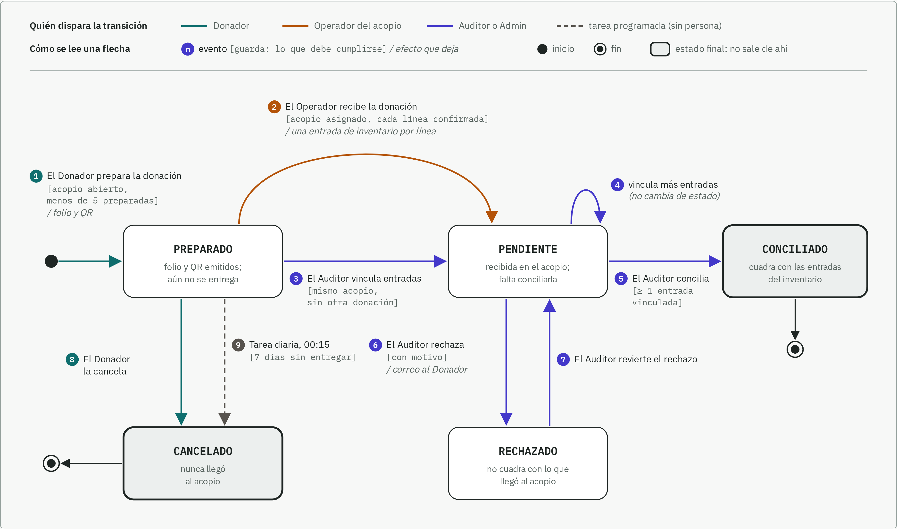
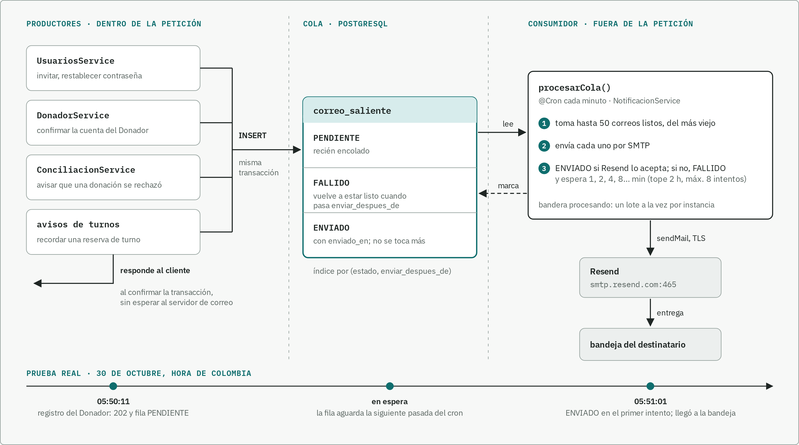

# Complemento de la sustentación del segundo corte

Para la sustentación del 30 de octubre de 2026, el docente pidió tres cosas
([guía](../talleres/Complemento%20Proyecto%20–%20IS1.pdf)): el diagrama de paquetes al día con un
ADR-002 que lo explique, un diagrama de comportamiento que corresponda a lo implementado y, como
bonificación opcional, un patrón de concurrencia integrado a una funcionalidad. Cada sección
presenta el diagrama, explica cómo leerlo y lo amarra al código, para que se pueda revisar contra
el repositorio.

Los tres diagramas se dibujan a mano en SVG, en `docs/02-arquitectura/diagramas/`
(`paquetes.html`, `comportamiento.html` y `concurrencia.html`), y se exportan a PNG con Playwright.
El Word sale de esta nota con [generar-complemento.py](generar-complemento.py) y se une al
documento compartido con [unificar-avances.py](unificar-avances.py).

## 1. Diagrama de paquetes y ADR-002

### 1a. Qué muestra el diagrama de paquetes

El diagrama tiene dos láminas. La primera muestra el repositorio completo: la web, la API, el
código compartido, los colores, el esquema de la base y la infraestructura. La segunda entra en la
API y muestra sus doce módulos. Cada caja es una carpeta real del repositorio y lleva su ruta.
Adentro aparecen las clases que más pesan en ese paquete, con su nombre en el código y su
estereotipo («servicio», «controlador», «interfaz», «dao»).

En la primera lámina, la flecha continua significa «importa código de» y la punteada «genera,
exporta o llama por HTTP». La web nunca importa código de la API: le habla por HTTP en `/api` y
toma los tipos del contrato `openapi.json`, que la API exporta. Lo único que comparten es
`packages/shared`, donde viven las fórmulas del motor y las unidades, para que la web muestre el
mismo número que calcula la API.

La segunda lámina se lee de arriba hacia abajo. El riel de la izquierda nombra las cinco capas y
dice qué resuelve cada una. Cada flecha es un `import` que existe en el código, y todas apuntan
hacia abajo o hacia un módulo de la misma capa; ninguna sube. Los módulos que usan casi todos,
`identidad` (sesión y permisos) y `auditoria` (bitácora), se marcan con una etiqueta y no con
flechas, porque doce flechas más taparían el resto.

| Capa | Módulos | Qué resuelve | De qué depende, además de `identidad` y `auditoria` |
|---|---|---|---|
| 1. Integración | `importacion` | Trae puntos de acopio de RedAcopio y de archivos CSV | `acopios`, `catalogo`, `inventario`, `turnos`, `almacenamiento` |
| 2. Procesos | `motor`, `turnos` | El motor calcula necesidad, excedentes, sugerencias y remisiones; turnos maneja jornadas, reservas y asistencia | `motor`: `comprobantes`, `inventario`, `acopios`, `catalogo`, `almacenamiento`. `turnos`: `acopios`, `notificaciones` |
| 3. Registro | `comprobantes`, `inventario` | Las donaciones con folio y los movimientos de inventario, de los que sale el saldo | `comprobantes`: `inventario`, `acopios`, `catalogo`, `almacenamiento`, `notificaciones`. `inventario`: `acopios`, `catalogo` |
| 4. Red y catálogo | `acopios`, `catalogo` | Dónde se recibe (acopios, zonas, entidades, causas) y qué se recibe (categorías, códigos de barras, canasta, emergencias) | `acopios`: `almacenamiento` |
| 5. Transversales | `identidad`, `auditoria`, `notificaciones`, `almacenamiento`, `salud` | Sesión, bitácora, cola de correo, archivos en Garage y chequeo de salud | `identidad`: `notificaciones` |

El 30 de octubre comparamos el diagrama con los imports reales y faltaba una dependencia: solo
estaba dibujada la de `comprobantes` hacia `almacenamiento`, y también dependen de él `acopios`,
`motor` e `importacion`. Ahora la etiqueta junto a esa flecha los nombra. La regla de capas no
depende de que alguien la recuerde: dependency-cruiser la revisa en cada pull request y el CI falla
si un módulo importa a uno que no tiene permitido.

### 1b. ADR-002 · Organización del código en paquetes

En el repositorio es el [ADR-0023](../02-arquitectura/adr/ADR-0023-organizacion-en-paquetes.md):
el número 0002 ya era otra decisión y los números no se reutilizan. El ADR-001 del curso es el
ADR-0008 del repositorio.

| Elemento | Qué decidimos |
|---|---|
| Contexto | Somos cuatro personas y cada una tiene módulos propios, así que la estructura de carpetas tenía que evitar que el cambio de una tocara archivos de otra. La web y la API cambian juntas y usan las mismas fórmulas del motor. La bitácora se escribe en la misma transacción que cada cambio y el saldo sale de los movimientos, lo que obliga a una sola base y un solo proceso. RNF-13 exige módulos sin dependencias circulares |
| Decisión | Un monorepo con `apps/web`, `apps/api`, `packages/shared` (funciones puras de las dos apps), `packages/ui-tokens` (colores), `prisma/` e `infra/`. La web solo habla con la API por HTTP y toma los tipos del contrato OpenAPI. En la API, un módulo por dominio, apilado en las cinco capas del diagrama. Un módulo importa a los de capas inferiores y, en dos casos, a uno de su misma capa (`comprobantes` usa `inventario`; `identidad` usa `auditoria` y `notificaciones`). Ninguno importa hacia arriba, y dependency-cruiser lo revisa en CI. Cuando un módulo de abajo necesita algo de uno de arriba, declara un puerto en `comun/` y el de arriba lo implementa (`VerificadorUbicaciones`, `ProveedorIdentidad`) |
| Alternativa considerada | Organizar por capas técnicas, con carpetas globales de controladores, servicios y repositorios, donde cualquier servicio puede llamar a cualquier otro. También separar la web y la API en dos repositorios |
| Justificación | Cada módulo es un límite del dominio y casi siempre lo que una persona tiene asignado. La regla de dependencias la revisa una herramienta en cada PR. Las fórmulas se escriben una sola vez. Con capas técnicas, las cuatro personas tocarían las mismas carpetas y nada impediría que el motor leyera tablas de otro módulo. Con dos repositorios, un cambio de endpoint necesitaría dos PR coordinados y `packages/shared` tendría que publicarse como paquete |
| Consecuencias | Facilita ubicar un cambio, medir qué afecta y cambiar la web y la API en el mismo PR. Limita las llamadas hacia arriba, que necesitan un puerto, y deja todo en un proceso: el motor no se puede escalar aparte. Puede requerir ajustes: `motor` ya depende de siete módulos y convendría partirlo si sigue creciendo, y la cola de correo solo es segura con una instancia de la API (P-089) |

## 2. Diagrama de comportamiento: estados de la donación

### 2a. Qué representa y por qué un diagrama de estados

El diagrama sigue el ciclo de vida de una donación (tabla `comprobante`, enum
`EstadoComprobante`): desde que el Donador la prepara en el portal hasta que un Auditor la
concilia contra las entradas de inventario, la rechaza, o hasta que se cancela. Corresponde a la
historia HU-006 («Comprobar que mi donación llegó») y a los requerimientos RF-CMP-001B (preparar
una donación), RF-CMP-001C (confirmar la recepción física), RF-CMP-004 (conciliar), RF-CMP-005
(rechazar) y RF-CMP-006 (seguimiento por folio).

Elegimos un diagrama de estados porque en la donación intervienen cuatro actores (Donador,
Operador, Auditor y una tarea programada) y lo que cada uno puede hacer depende del estado en que
la encuentra. Un diagrama de actividades habría repartido esas reglas entre carriles y no dejaría
ver de un vistazo, por ejemplo, que un rechazo se puede revertir y una conciliación no.

### 2b. Cómo leerlo

- Cada caja es un estado; la frase debajo del nombre dice qué significa para la persona que
  donó. Las cajas grises de borde grueso (CONCILIADO y CANCELADO) son estados finales: de ahí la
  donación no sale.
- El color de la flecha dice quién dispara el cambio: verde azulado el Donador, ocre el Operador
  del acopio, índigo el Auditor (o el Admin) y gris punteado la tarea programada, que corre sin
  que nadie la pida.
- Cada etiqueta sigue la notación UML: primero el evento, entre corchetes la guarda (la condición
  que la API exige) y después de la barra el efecto que deja la transición.
- Los números del 1 al 9 son los mismos de la tabla de abajo, que dice qué método del código
  implementa cada flecha.

### 2c. Recorridos

El recorrido normal es 1 → 2 → 5. El Donador prepara la donación y recibe un folio con su QR. La
lleva al acopio, donde el Operador escanea el folio, confirma cada línea y la API registra una
entrada de inventario por línea (2). Luego el Auditor revisa que lo recibido cuadre con esas
entradas y la concilia (5).

Los otros caminos cubren lo que pasa en la práctica:

- La donación llegó, pero las entradas se registraron sin escanear el folio. El Auditor las
  vincula después (3), y puede seguir vinculando más mientras esté PENDIENTE (4).
- Lo recibido no cuadra. El Auditor la rechaza con un motivo y el Donador recibe un correo por la
  cola de la sección 3 (6). Si el rechazo fue un error, el Auditor lo revierte (7).
- La donación nunca llegó. El Donador la cancela (8) o, si pasan siete días sin entregarla, la
  tarea diaria de las 00:15 la cancela sola (9).

| # | Transición | Quién | Guarda que exige la API | Método |
|---|---|---|---|---|
| 1 | inicio → PREPARADO | Donador | El acopio está abierto y el Donador tiene menos de 5 donaciones preparadas | `DonacionesService.crear` |
| 2 | PREPARADO → PENDIENTE | Operador | Tiene asignado ese acopio y confirma cada línea una vez | `RecepcionService.recibir` |
| 3 | PREPARADO → PENDIENTE | Auditor o Admin | Las entradas son del mismo acopio y no pertenecen a otra donación | `ConciliacionService.vincular` |
| 4 | PENDIENTE → PENDIENTE | Auditor o Admin | Igual que 3 | `ConciliacionService.vincular` |
| 5 | PENDIENTE → CONCILIADO | Auditor o Admin | Hay al menos una entrada vinculada | `ConciliacionService.conciliar` |
| 6 | PENDIENTE → RECHAZADO | Auditor o Admin | Indica un motivo; si el Donador tiene correo, se encola el aviso | `ConciliacionService.rechazar` |
| 7 | RECHAZADO → PENDIENTE | Auditor o Admin | El acopio está en su alcance | `ConciliacionService.revertirRechazo` |
| 8 | PREPARADO → CANCELADO | Donador | La donación es suya | `DonacionesService.cancelar` |
| 9 | PREPARADO → CANCELADO | Tarea `preparadas-vencidas` | Pasaron 7 días sin entregarla | `TareasCustodiaService.cancelarVencidas` |

Los límites de 5 preparadas y 7 días son los valores por defecto de `PREPARADAS_MAXIMO` y
`PREPARADA_VIGENCIA_DIAS`. Los métodos viven en `apps/api/src/modulos/comprobantes/`.

### 2d. Dos transiciones a la vez

Las flechas 2 y 9 salen del mismo estado y pueden coincidir: el Operador recibe un folio en el
mismo minuto en que la tarea diaria lo cancela. Cada cambio de estado exige el estado de origen
dentro del mismo `UPDATE` (`cambiarSiEstado` del DAO de comprobantes), así que la segunda
operación ya no encuentra la fila en PREPARADO y no cambia nada. La donación nunca queda recibida y
cancelada al mismo tiempo.

## 3. Bonificación: productor y consumidor con la cola de correo

### 3a. El problema

Varias operaciones mandan un correo: invitar a un usuario, restablecer una contraseña, confirmar
la cuenta de un Donador, avisar que una donación se rechazó y recordar un turno. Si el correo se
enviara dentro de la petición, un servidor de correo lento haría esperar a quien invita, y uno
caído haría fallar la invitación aunque el usuario ya estuviera creado. Al revés también hay
riesgo: si la operación fallara después de enviar, el correo ya habría salido con un enlace que no
sirve.

### 3b. Componentes y cómo se comunican

Productores y consumidor no se llaman entre sí. Lo único que comparten es la tabla
`correo_saliente`, y por eso trabajan a ritmos distintos: la petición termina a la izquierda de la
primera línea punteada del diagrama y el envío ocurre a la derecha, después.

| Componente | Papel | Dónde está en el código |
|---|---|---|
| `UsuariosService`, `DonadorService`, `ConciliacionService` y los avisos de `turnos` | Productores. Llaman a `NotificacionService.encolar` dentro de la transacción de su operación: si la operación se deshace, el correo tampoco queda | `notificacion.service.ts`, método `encolar` (línea 56); un uso en `identidad/usuarios/usuarios.service.ts`, línea 131 |
| Tabla `correo_saliente` | Cola. Guarda el estado (PENDIENTE, ENVIADO o FALLIDO), los intentos, el último error y `enviar_despues_de`. Tiene un índice por estado y fecha, que es la consulta del consumidor | Modelo `CorreoSaliente` en `prisma/schema.prisma`; consultas en `notificaciones/dao/correo-saliente.dao.ts` |
| `NotificacionService.procesarCola` | Consumidor. Corre cada minuto (`@Cron`), toma hasta 50 correos listos del más viejo al más nuevo y los envía | `notificacion.service.ts`, `procesarCola` (líneas 62 a 79) y `enviar` (81 a 114) |
| Resend | Servidor de correo, por SMTP (`smtp.resend.com`, puerto 465 con TLS). La API no usa el SDK de Resend: cambiar de proveedor es cambiar variables | `.env.example` y P-055 |

Cuando un envío falla, el consumidor marca el correo FALLIDO y le pone una espera que se duplica
en cada intento (1, 2, 4, 8 minutos, hasta 2 horas). Cuando pasa esa espera vuelve a estar listo,
y después de 8 intentos se deja de reintentar.

### 3c. Evidencia de funcionamiento

- Pruebas de integración contra PostgreSQL (`src/pruebas-integracion/notificaciones.int.test.ts`):
  con el servidor de correo arriba el correo queda ENVIADO; con el servidor caído queda FALLIDO,
  espera y sale solo cuando el servidor vuelve; después del máximo de intentos no se reintenta; y
  con `CORREO_ACTIVO=false` no se encola nada.
- Prueba real con Resend el 30 de octubre, en la API local. Un registro de Donador para
  `contacto@josephqaz.dev` respondió 202 de inmediato y dejó el correo de confirmación en la cola a
  las 05:50:11. El consumidor lo tomó en su siguiente pasada y Resend lo aceptó a las 05:51:01, en
  el primer intento. El correo llegó a la bandeja desde `no-reply@josephqaz.dev`.

El correo de confirmación en la bandeja de `contacto@josephqaz.dev`, con el enlace para
confirmar la cuenta:

### 3d. Limitaciones y fallos considerados

- Servidor de correo caído o lento: es el caso que la cola resuelve. La operación no se entera y el
  correo se reintenta solo, y una prueba de integración lo cubre.
- Dos consumidores a la vez: la bandera `procesando` evita que un lote empiece antes de que
  termine el anterior, pero solo dentro de una instancia de la API. Con dos instancias, las dos
  leerían las mismas filas y el correo saldría dos veces. Hoy corre una sola. El arreglo es
  reclamar el lote con `SELECT … FOR UPDATE SKIP LOCKED`, y quedó anotado como
  [P-089](../01-requerimientos/pendientes.md).
- Caída entre enviar y marcar: si la API se cae después de que Resend acepta el correo y antes de
  marcarlo ENVIADO, el siguiente lote lo vuelve a enviar. La entrega es «al menos una vez»; para
  una invitación, un correo repetido es preferible a uno perdido.
- Hasta un minuto de espera, porque el consumidor corre cada minuto.
