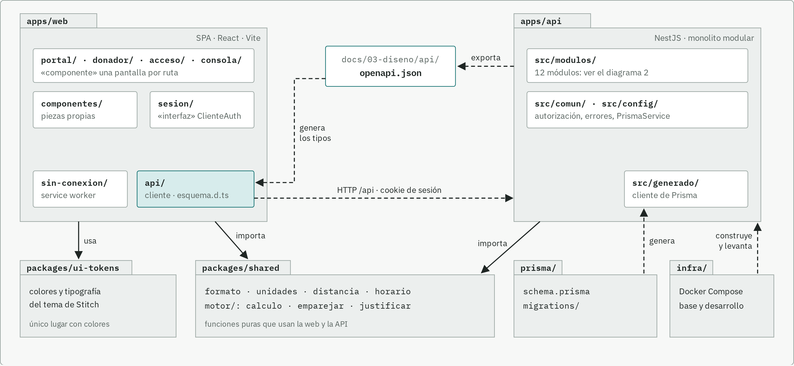
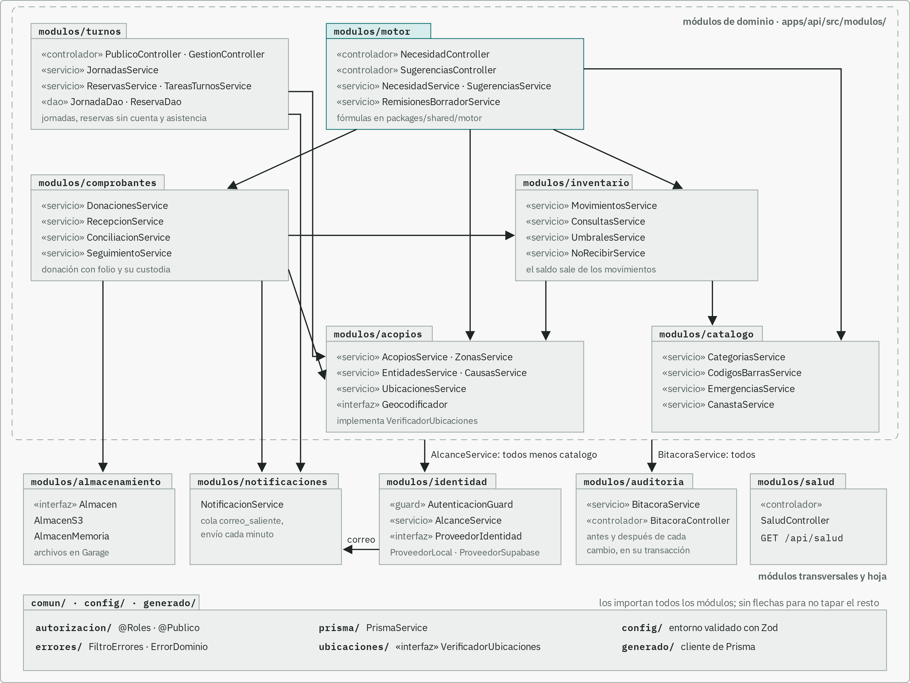
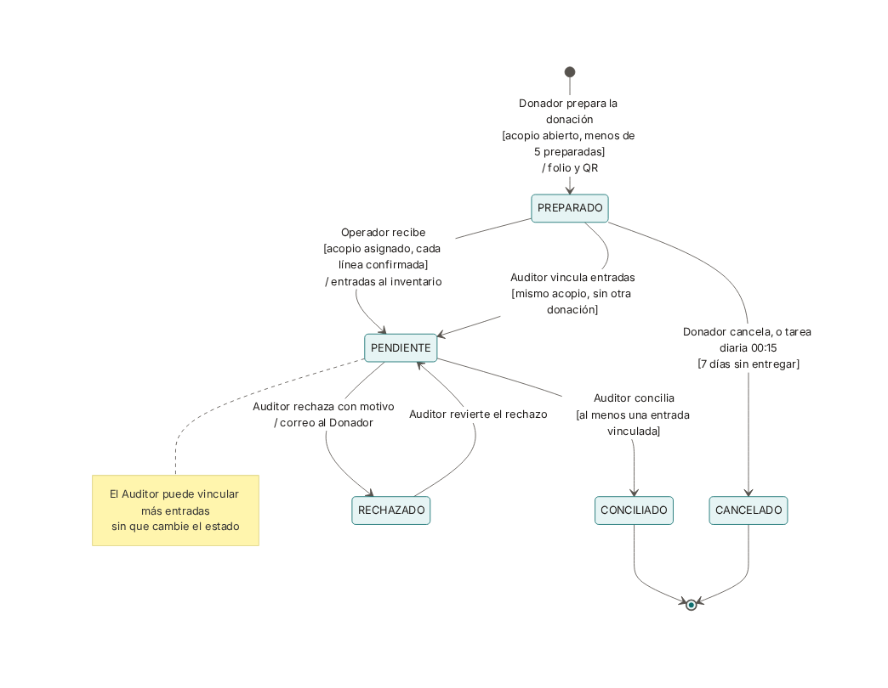
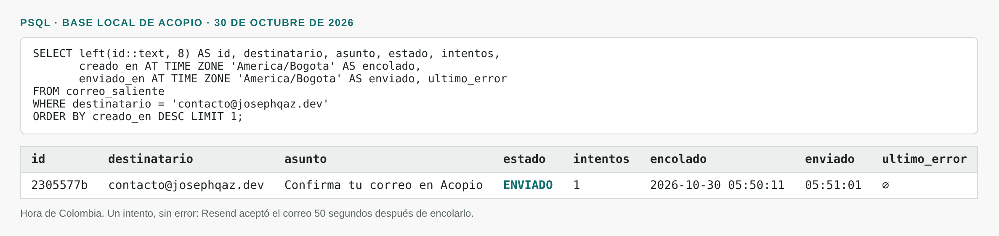
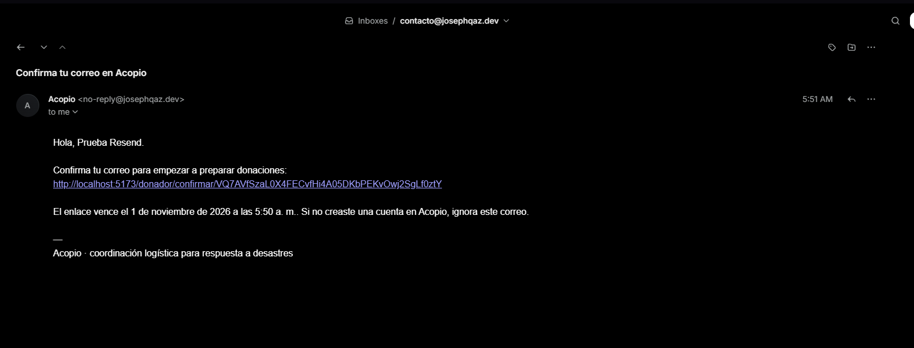

# Complemento de la sustentación del segundo corte

Lo que pidió el docente para la sustentación del 30 de octubre de 2026
([guía](../talleres/Complemento%20Proyecto%20–%20IS1.pdf)): el diagrama de paquetes al día con su
ADR-002, un diagrama de comportamiento y, como bonificación opcional, un patrón de concurrencia.
El Word sale de esta nota con [generar-complemento.py](generar-complemento.py) y se une al
documento compartido con [unificar-avances.py](unificar-avances.py). El plan está en
[2026-10-30-complemento-sustentacion.md](../05-planes/2026-10-30-complemento-sustentacion.md).

## 1. Diagrama de paquetes y ADR-002

### 1a. Diagrama de paquetes

El diagrama se dibuja a mano en `docs/02-arquitectura/diagramas/paquetes.html` y tiene dos
láminas. La primera muestra el monorepo y la segunda los doce módulos de la API. El 30 de octubre
lo comparamos con los imports reales del código: los doce módulos coincidían, pero solo estaba
dibujada la dependencia de `comprobantes` hacia `almacenamiento`. También dependen de
`almacenamiento` los módulos `acopios`, `motor` e `importacion`, y ahora el diagrama lo dice con
una etiqueta, como ya hacía con `identidad` y `auditoria`.

### 1b. ADR-002 · Organización del código en paquetes

En el repositorio es el [ADR-0023](../02-arquitectura/adr/ADR-0023-organizacion-en-paquetes.md),
porque el número 0002 ya era otra decisión y los números no se reutilizan. El ADR-001 del curso
es el ADR-0008 del repositorio.

| Elemento | Qué decidimos |
|---|---|
| Contexto | Somos cuatro personas, cada una con módulos propios. La web y la API cambian juntas y usan las mismas fórmulas del motor. La bitácora se escribe en la misma transacción que cada cambio y el saldo sale de los movimientos, así que todo vive en una sola base. RNF-13 exige módulos sin dependencias circulares |
| Decisión | Un monorepo con `apps/web`, `apps/api`, `packages/shared` (funciones puras de las dos apps), `packages/ui-tokens` (colores), `prisma/` e `infra/`. La web solo habla con la API por HTTP y toma los tipos del contrato OpenAPI. En la API, un módulo por dominio, apilados en capas: `importacion`; luego `motor` y `turnos`; luego `comprobantes` e `inventario`; luego `acopios` y `catalogo`; y abajo los transversales (`identidad`, `auditoria`, `notificaciones`, `almacenamiento`, `salud`). Cada módulo importa solo a los de abajo, y dependency-cruiser lo revisa en CI |
| Alternativa considerada | Organizar por capas técnicas, con carpetas globales de controladores, servicios y repositorios. También separar la web y la API en dos repositorios |
| Justificación | Cada módulo es un límite del dominio y casi siempre lo que una persona tiene asignado. La regla de dependencias la revisa una herramienta en cada PR. Las fórmulas se escriben una sola vez y la web muestra el mismo número que calcula la API. Por capas técnicas, las cuatro personas tocarían las mismas carpetas y nada impediría que el motor leyera tablas ajenas |
| Consecuencias | Facilita ubicar un cambio, medir su impacto y cambiar la web y la API en el mismo PR. Limita las llamadas hacia arriba: cuando hacen falta, se resuelven con un puerto en `comun/` (`VerificadorUbicaciones`, `ProveedorIdentidad`). Todo corre en un proceso. Puede requerir ajustes: `motor` ya depende de siete módulos y convendría partirlo si sigue creciendo, y la cola de correo solo es segura con una instancia de la API |

## 2. Diagrama de comportamiento: estados de la donación

El diagrama sigue a una donación (tabla `comprobante`, enum `EstadoComprobante`) desde que el
Donador la prepara en el portal hasta que un Auditor la concilia contra las entradas de
inventario o la rechaza. Corresponde a la historia HU-006 («Comprobar que mi donación llegó») y a
los requerimientos RF-CMP-001B (preparar), RF-CMP-001C (recibir), RF-CMP-004 (conciliar),
RF-CMP-005 (rechazar) y RF-CMP-006 (seguimiento por folio). Las guardas son reglas de negocio que
la API hace cumplir: un Donador tiene como máximo cinco donaciones preparadas, una preparada vence
a los siete días, solo el Operador asignado al acopio la recibe y nadie concilia sin una entrada
vinculada. Elegimos un diagrama de estados porque en la donación intervienen cuatro actores
(Donador, Operador, Auditor y una tarea programada), y lo que cada uno puede hacer depende del
estado en que la encuentra. En un diagrama de actividades esas reglas quedarían repartidas entre
carriles, y costaría ver que un rechazo se puede revertir y una conciliación no.

El modelo corresponde a lo implementado. Cada transición tiene un método del módulo
`comprobantes`:

| Transición | Quién | Método |
|---|---|---|
| inicio → PREPARADO | Donador | `DonacionesService.crear` |
| PREPARADO → CANCELADO | Donador | `DonacionesService.cancelar` |
| PREPARADO → CANCELADO | Tarea `preparadas-vencidas`, 00:15 hora de Colombia | `TareasCustodiaService.cancelarVencidas` |
| PREPARADO → PENDIENTE | Operador del acopio | `RecepcionService.recibir` |
| PREPARADO o PENDIENTE → PENDIENTE | Auditor o Admin | `ConciliacionService.vincular` |
| PENDIENTE → CONCILIADO | Auditor o Admin | `ConciliacionService.conciliar` |
| PENDIENTE → RECHAZADO | Auditor o Admin | `ConciliacionService.rechazar` |
| RECHAZADO → PENDIENTE | Auditor o Admin | `ConciliacionService.revertirRechazo` |

Cada cambio de estado exige el estado anterior en el mismo `UPDATE`. Si el Operador recibe un
folio en el mismo instante en que la tarea diaria lo cancela, una de las dos operaciones ya no
encuentra la fila en `PREPARADO` y no cambia nada. La nota completa está en
[comportamiento.md](../02-arquitectura/comportamiento.md).

## 3. Bonificación: productor y consumidor con la cola de correo

### Problema que resuelve

Varias operaciones mandan un correo: invitar a un usuario, restablecer una contraseña, confirmar
la cuenta de un Donador, rechazar una donación y recordar un turno. Si el correo se enviara dentro
de la petición, un servidor SMTP lento haría esperar a quien invita, y uno caído haría fallar la
invitación aunque el usuario ya estuviera creado. Además, si la operación fallara después de
enviar, el correo ya habría salido con un enlace que no sirve.

### Componentes y cómo se comunican

- Productores: `UsuariosService` (invitaciones y restablecimientos), `DonadorService`
  (confirmación de la cuenta), `ConciliacionService` (rechazo de una donación) y los avisos de
  `turnos`. Cada uno llama a `NotificacionService.encolar` dentro de la misma transacción que la
  operación. Si la operación se deshace, el correo tampoco queda en la cola.
- Cola: la tabla `correo_saliente`, con estado `PENDIENTE`, `ENVIADO` o `FALLIDO`, el número de
  intentos, el último error y `enviar_despues_de`. Tiene un índice por estado y fecha, que es la
  consulta del consumidor.
- Consumidor: `NotificacionService.procesarCola`, una tarea `@Cron` que corre cada minuto. Toma
  hasta 50 correos listos, del más viejo al más nuevo, y los envía por SMTP. Si uno falla, lo
  marca `FALLIDO` y lo reprograma con espera exponencial (1, 2, 4, 8 minutos y hasta dos horas),
  hasta ocho intentos.
- Proveedor: Resend, por SMTP (`smtp.resend.com`, puerto 465 con TLS) y con el remitente
  `no-reply@josephqaz.dev`. La API no usa el SDK de Resend; cambiar de proveedor es cambiar
  variables de entorno.

Productores y consumidor no se llaman entre sí. Solo comparten la tabla, así que la petición
responde en cuanto la transacción confirma y el envío ocurre después, a su propio ritmo.

### Código y evidencia

- Productor: `apps/api/src/modulos/notificaciones/notificacion.service.ts`, método `encolar`
  (línea 56). Un ejemplo de uso está en `modulos/identidad/usuarios/usuarios.service.ts`, línea 131.
- Consumidor: el mismo archivo, `procesarCola` (líneas 62 a 79) y `enviar` (líneas 81 a 114).
- Cola: `apps/api/src/modulos/notificaciones/dao/correo-saliente.dao.ts` y el modelo
  `CorreoSaliente` en `prisma/schema.prisma`.
- Pruebas de integración contra PostgreSQL (`src/pruebas-integracion/notificaciones.int.test.ts`):
  con el SMTP arriba el correo queda `ENVIADO`; con el SMTP caído queda `FALLIDO`, espera y sale
  solo cuando vuelve; después del máximo de intentos no se reintenta; y con `CORREO_ACTIVO=false`
  no se encola nada.
- Prueba real con Resend, el 30 de octubre en la API local: un registro de Donador para
  `contacto@josephqaz.dev` respondió 202 de inmediato y dejó el correo de confirmación en la cola
  a las 05:50:11. El consumidor lo tomó en su siguiente pasada y Resend lo aceptó a las 05:51:01,
  en el primer intento. El correo llegó a la bandeja desde `no-reply@josephqaz.dev`.

El correo de confirmación en la bandeja de `contacto@josephqaz.dev`, con el enlace para
confirmar la cuenta:

### Limitaciones y fallos considerados

- SMTP caído o lento: es el caso que la cola resuelve. La operación no se entera y el correo se
  reintenta solo. Lo cubre una prueba de integración.
- Dos consumidores a la vez: la bandera `procesando` evita que un lote empiece antes de que
  termine el anterior, pero solo dentro de una instancia de la API. Con dos instancias, las dos
  leerían las mismas filas y el correo saldría dos veces. Hoy corre una sola instancia. El arreglo
  es reclamar el lote con `SELECT … FOR UPDATE SKIP LOCKED` y quedó anotado como
  [P-089](../01-requerimientos/pendientes.md).
- Caída entre enviar y marcar: si la API se cae después de que Resend acepta el correo y antes de
  marcarlo `ENVIADO`, el siguiente lote lo vuelve a enviar. La entrega es «al menos una vez»; para
  una invitación, un correo repetido es preferible a uno perdido.
- Hasta un minuto de espera, porque el consumidor corre cada minuto.
