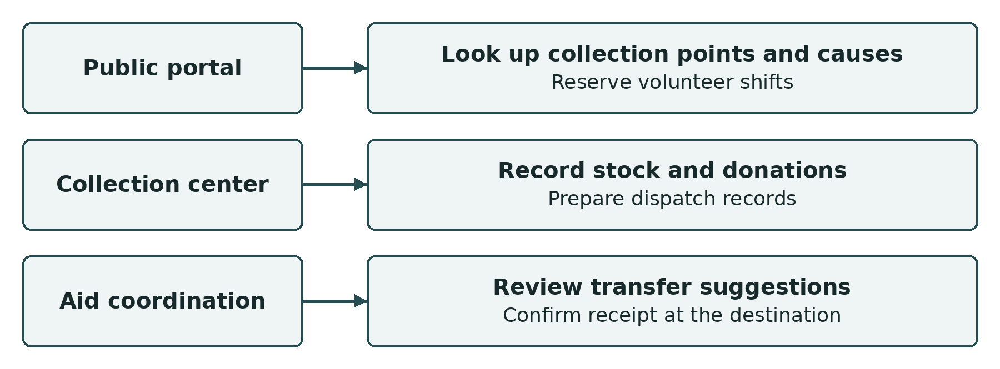
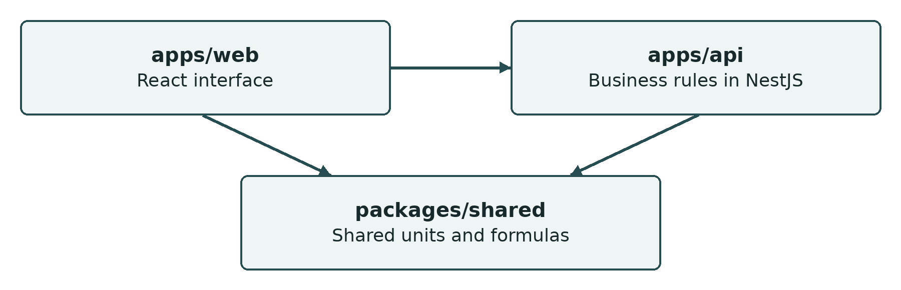
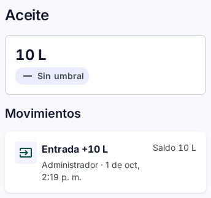
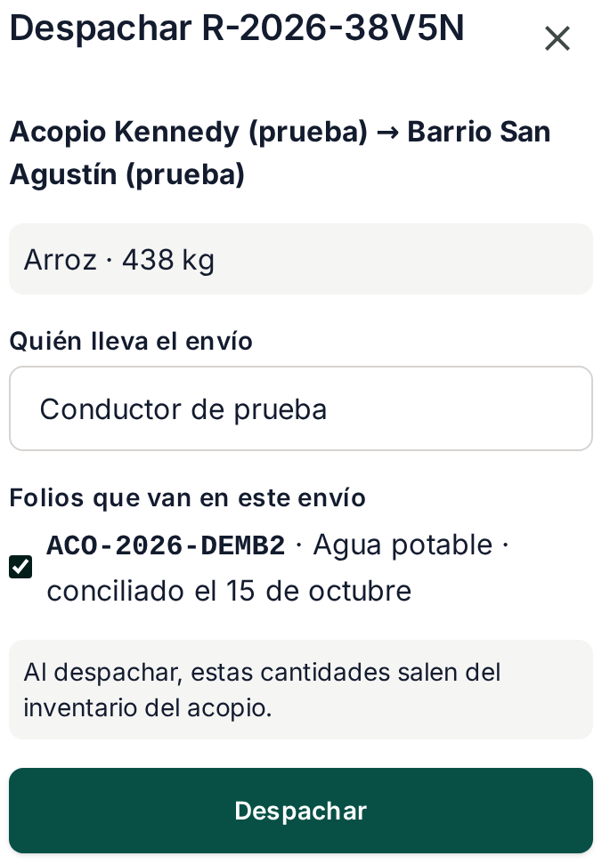
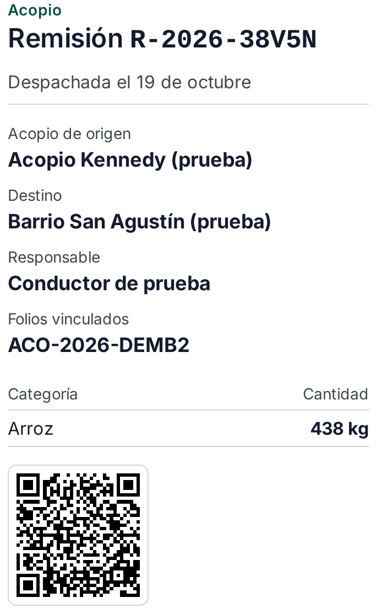

# Acopio: A Web Platform for Coordinating Donations During Disasters

## Introduction

During the response to a disaster, collection centers must decide which supplies they can receive, how much they can send and where it is needed. If each center keeps its own records, one of them may pile up an item that is scarce in another area. Needs also change as shipments arrive. For this reason, APC Colombia recommends confirming, before any aid is moved, that it meets a current need and that the destination can receive, store and distribute it (APC Colombia, 2026).

Acopio is an academic project of the Escuela Tecnológica Instituto Técnico Central (ETITC) that aims to make those decisions easier. On its public portal, people can find collection points, follow a donation with its tracking code (called *folio* in the application) and reserve volunteer shifts. In the staff console, personnel record inventory movements and review proposed transfers. The Administrator decides whether to approve a proposal, and the Receiver confirms what reached the destination. This leaves a record that the teams can consult after the dispatch (Acopio Team, 2026d, 2026e).

This report explains how the prototype was designed and what the test runs with demonstration data showed. These checks make it possible to examine how the application works. Its usefulness during a real emergency still has to be evaluated with the organizations that coordinate aid.

## Abstract

Acopio: A Web Platform for Coordinating Donations During Disasters is an academic project developed at Escuela Tecnológica Instituto Técnico Central. Its purpose is to help collection centers and affected areas share information about available supplies and outstanding needs, so that authorized staff can record inventory, follow donations and decide on transfers. The platform also gives the public information about collection points, verified causes and volunteer shifts. The methodology was an iterative software development process that covered problem analysis, requirements, architecture, implementation and testing. The team visited a collection center in Bogotá, wrote user stories for each role and built the application with React, NestJS and PostgreSQL. Humanitarian guidance and population data served as references for estimating needs, and their values must be adjusted to the local context in each response. The results come from demonstrations with test data in a controlled environment. The prototype records inventory and donations, suggests transfers with a visible score, confirms deliveries, publishes verified causes and accepts shift reservations. In the local run of October 19, 2026, all nine checks of the suggestion engine, all seven dispatch checks and all seven receipt checks passed. In conclusion, a shared record and suggestions with explicit criteria can support coordination, because staff can review each proposal before dispatch and record what arrived. The effectiveness of the platform in the field remains unmeasured. Further work includes trials with humanitarian organizations, a review of the assumptions behind the needs calculation and a usability evaluation under emergency conditions.

Keywords: disaster response, humanitarian logistics, donations in kind, inventory management, software engineering.

## Background

The first progress report of the project documents a visit to a collection center in Bogotá on August 20, 2026. The team recorded that supplies arrived unevenly, that it was difficult to assign tasks to volunteers and that the staff who sorted and dispatched the aid were overloaded. The visit helped the team define the problem at that center. Its scope was exploratory (Acopio Team, 2026a).

The guidelines that APC Colombia issued after the August earthquake recommend checking with the local authority that the aid meets a current need and that there are means to receive, store and distribute it. A directory of collection points makes it easier to find the centers. To coordinate distribution, teams also need to know which supplies each point can receive, what it has available and where each load is sent (APC Colombia, 2026; Acopio Team, 2026a).

## Justification

The purpose of the project is to give collection centers, affected areas and the public a shared record of donations, so that aid can be sent where it is needed and followed until it arrives. A center that does not know what the others have may keep receiving an item it can no longer store. At the same time, an area with little coverage may be left out of the distribution routes. When balances and needs are shared, coordinators can identify a possible transfer and check whether they have the means to carry it out. The portal also tells donors where they can deliver their donations and lets volunteers reserve a shift with available places.

The project applies software engineering to decisions that depend on correct records and explicit responsibilities. The design requires an approval before dispatch and keeps a record of what the Receiver confirms at the destination (Acopio Team, 2026e, section 1a).

## Objectives

### General objective

To develop a web platform that supports the coordination of donations in kind between collection centers and affected areas through shared inventory, tracking by code and transfer suggestions.

### Specific objectives

1. To define the requirements of donors, volunteers, operators and coordinators.
2. To record inventory movements and make it easier to follow donations by their tracking code.
3. To suggest transfers based on the needs of the affected areas and the available stock, with approval before dispatch.
4. To publish information about collection points and verified causes, and to allow people to reserve volunteer shifts.
5. To check representative workflows of the prototype with test data and to document its limitations.

## Problem statement

When each center keeps its own records, teams have difficulty comparing what is needed with what is already available. A donor may deliver an item that the center has no capacity to store. When a load is dispatched, staff need to record both its departure and its arrival at the destination. Without that information it is difficult to reconstruct the route of the aid (Acopio Team, 2026a, 2026b).

### Problem question

How can a web platform support the coordination and traceability of donations in kind between collection centers and affected areas during the response to a disaster?

## Proposed solution

Acopio brings together the public portal and the tools for authorized staff. On the portal, people can look up collection points, verified causes and volunteer shifts. In the console, the Operator records stock and donations, the Administrator reviews the proposed transfers and the Receiver confirms the delivery. Figure 1 shows how the project distributes these responsibilities (Acopio Team, 2026e, section 1).

## Critical analysis

The usefulness of the suggestion engine depends on the quality of the records. An outdated balance can produce a proposal that is difficult to fulfill. The population figure, the age of the reports and the composition of the food basket also change the calculation. The coordinator must review the proposal against local information, the capacity to receive the load and the available transport (APC Colombia, 2026; Acopio Team, 2026f).

Limited connectivity during an emergency can restrict the use of the application. The available tests were carried out with network access and demonstration data. Adoption also depends on the organizations agreeing on who updates the inventory, verifies the causes and confirms the deliveries. Acopio links to the websites of the organizations that receive financial contributions (Acopio Team, 2026e).

## Methodology

The team compared project ideas, formulated requirements by role and organized them into user stories. In the following progress reports it defined the architecture, implemented increments and documented test runs in the browser. Appendices A, B and C present the selection of the idea, the requirements and the initial design, respectively. To check the workflow, the browser test runs simulated the calculation and approval of a suggestion, the dispatch and the confirmation in the affected area (Acopio Team, 2026e, section 3c).

The food basket was reviewed separately. The assumptions of the project were compared with humanitarian references, and those that require adjustment or specialized validation were identified (Acopio Team, 2026f). The software tests were interpreted as evidence of how the prototype behaves under controlled conditions.

## Tools

The interface was developed in React and the API in NestJS. PostgreSQL stores the records and Prisma provides access to the database. Docker Compose makes it possible to reproduce the development environment, and GitHub records changes and automatic checks (Acopio Team, 2026e, section 1). Figure 2 shows the division between the web application, the API and the shared packages.

## Project development

### Theoretical framework

Logistics traceability connects the entry of a supply with its departure and the confirmation of its receipt. In Acopio, the tracking code identifies the donation and the dispatch record (*remisión*) documents the transfer. Inventory movements show why a balance changed. These records make it possible to review a difference between what was dispatched and what arrived (Acopio Team, 2026b, 2026e).

The Sphere Handbook provides planning references, such as 15 liters of water per person per day for basic household needs and 2,100 kilocalories per person per day for planning general rations. The amount of water covers uses such as drinking, hygiene and cooking. Both values require adjustments according to the population and the context (Asociación Esfera, 2018).

The study of the Acopio food basket found that the quantities of each food are decisions of the project. The Sphere Handbook does not prescribe the grams of rice, legumes or oil used in the proposal. The study identified limitations in fat and protein that must be reviewed before the basket is used in a real distribution. The family kits of the National Unit for Disaster Risk Management (UNGRD) offer a point of comparison, as long as the household size and the coverage period are stated. The projections of the National Administrative Department of Statistics (DANE) serve as a population reference. Staff in the field must establish how many people need assistance (Acopio Team, 2026f; Departamento Administrativo Nacional de Estadística, n.d.; Unidad Nacional para la Gestión del Riesgo de Desastres, 2013).

### Inventory and donation tracking

The Operator records entries, exits and adjustments. Figure 3 shows how the history links an entry of oil with the balance that resulted from the movement. The reconciliation records who did it and when (Acopio Team, 2026d, section 3c).

The public lookup by tracking code shows the supplies and the status. In Figure 4 the donation is prepared, and the steps of receipt at the collection center and reconciliation are still pending. The screen omits the identity of the donor and the invoice (Acopio Team, 2026d, section 3c).

### Transfer engine and receipt

The engine multiplies the daily quantity per person by the population and the days of the period. It subtracts what has been received and what is on the way. Then it compares the shortage with the stock that the collection center can move, taking into account its thresholds, expired products and the quantities already committed. Figure 5 shows the breakdown of the score into criticality, urgency, proximity and magnitude (Acopio Team, 2026g).

For example, if an area needs 100 units, has received 30 and expects 20, it still needs 50. A center that can deliver 35 units would cover up to 35 of them in that transfer.

The Administrator reviews the quantity and can adjust it before approving. The notice in Figure 6 explains that the approval adds the transfer to a draft dispatch record, or creates one if necessary (Acopio Team, 2026e, section 1a).

The Administrator or the Operator of the center of origin can dispatch the load. Figure 7 shows the person responsible and the selected tracking code before confirmation. Figure 8 shows the document generated for that dispatch, with the same code and its QR (Acopio Team, 2026e, 2026i).

The assigned Receiver confirms the quantity that arrived and attaches a photo. Figure 9 shows the confirmation of another demonstration dispatch (Acopio Team, 2026e, 2026i).

### Public portal and volunteering

The map distinguishes the centers of Acopio from the points referenced from RedAcopio Bogotá. The legend in Figure 10 identifies the origin of the data so that visitors know which type of point they are looking at (Acopio Team, 2026e, section 1c).

People can look up causes of verified organizations. Figure 11 shows the badge and the verification date on the page of a cause. For financial contributions, the page directs people to the official website of the organization (Acopio Team, 2026e, section 1b).

Figure 12 shows the step before the badge: the Administrator confirms having reviewed the organization and its official website. In the screenshot, the box is still unchecked and the verification button is inactive. The publication form only offers verified organizations (Acopio Team, 2026e, section 1b).

Volunteers can reserve shifts with available places. The confirmation indicates the code, the date, the time and the place. Figure 13 makes it possible to distinguish that confirmation from the screen where the place is requested (Acopio Team, 2026e, section 1c).

### Scope

The prototype covers public information, inventory, donation tracking, transfers and reservations. It was evaluated with development test runs. Its usefulness in a real response and its performance with intermittent connectivity still have to be checked.

## Results

Progress Report 5 documents the workflow from the suggestion to the receipt, as well as the verification of organizations and the volunteering screens. For the local run of October 19, the guide records nine of nine checks for the engine, seven of seven for the dispatch and seven of seven for the receipt. These are results of software tests with demonstration data (Acopio Team, 2026e, 2026i).

The review of October 19, carried out by one team member with demonstration accounts, confirmed that the system blocked a transfer that exceeded the available quantity. It also recorded that a warning about outdated inventory was missing and that one screen could be opened even though the API denied the change. These observations show why it is useful to test the interface and the authorization of the API separately (Acopio Team, 2026h).

## Analysis of results and conclusions

### Analysis of results

The test runs show that the prototype connects a suggestion with the dispatch and the confirmation of arrival. The Administrator can review the justification before approving the transfer, and the Receiver records what actually arrived. The results correspond to tests with demonstration data. The team has not yet measured delivery times, adoption or impact in an emergency.

### Conclusions

In answer to the problem question, the prototype supports coordination with a shared inventory and with suggestions that a person must approve. It supports traceability with the tracking code, the dispatch record and the confirmation of receipt. So far this has been shown only with demonstration data.

The research on the food basket showed that a calculation can work as designed and still depend on assumptions that need review. Before the basket is used in real operations, its composition and the population data must be reviewed with specialized staff.

A field trial should check whether teams can keep the records up to date, interpret the suggestions and compare them with local needs.

## Bibliography

Acopio Team. (2026a). *Avance 1: Sprint 0. Selección y definición inicial del producto* [Progress report 1: Sprint 0. Selection and initial definition of the product] [Course assignment]. ETITC.

Acopio Team. (2026b). *Avance 2: Requisitos y planeación inicial* [Progress report 2: Requirements and initial planning] [Course assignment]. ETITC.

Acopio Team. (2026c). *Avance 3: Arquitectura inicial* [Progress report 3: Initial architecture] [Course assignment]. ETITC.

Acopio Team. (2026d). *Avance 4: Sprint 1* [Progress report 4: Sprint 1] [Course assignment]. ETITC.

Acopio Team. (2026e). *Avance 5: Sprint 2. Interfaz funcional y patrones de diseño* [Progress report 5: Sprint 2. Functional interface and design patterns] [Course assignment]. ETITC.

Acopio Team. (2026f). *Canasta estándar Acopio: Validación* [Acopio standard food basket: Validation] [Internal research report].

Acopio Team. (2026g). *Código fuente del cálculo de necesidades y emparejamiento* [Source code of the needs calculation and matching] [Source code]. GitHub. https://github.com/Proyecto-IngSoftware/acopio/tree/main/packages/shared/src/motor

Acopio Team. (2026h, October 19). *Ronda de pruebas por rol en el servidor* [Round of tests by role on the server] [Session report]. GitHub. https://github.com/Proyecto-IngSoftware/acopio/blob/main/docs/06-operacion/sesiones/2026-10-19-ronda-por-rol.md

Acopio Team. (2026i, October 30). *Recorridos de punta a punta* [End-to-end test runs] [Test log]. GitHub. https://github.com/Proyecto-IngSoftware/acopio/blob/main/docs/06-operacion/recorridos.md

APC Colombia. (2026, August 12). *Orientaciones para articular las donaciones y ayudas humanitarias destinadas a las víctimas del terremoto* [Guidelines for coordinating donations and humanitarian aid for the victims of the earthquake]. https://www.apccolombia.gov.co/comunicaciones/noticias/apc-colombia-emite-orientaciones-para-articular-las-donaciones-y-ayudas

Asociación Esfera. (2018). *El Manual Esfera: Carta Humanitaria y normas mínimas para la respuesta humanitaria* [The Sphere Handbook: Humanitarian Charter and minimum standards in humanitarian response] (4th ed.). https://spherestandards.org/wp-content/uploads/El-manual-Esfera-2018-ES.pdf

Departamento Administrativo Nacional de Estadística. (n.d.). *Proyecciones de población* [Population projections]. https://www.dane.gov.co/index.php/estadisticas-por-tema/demografia-y-poblacion/proyecciones-de-poblacion

Unidad Nacional para la Gestión del Riesgo de Desastres. (2013). *Manual de estandarización de ayuda humanitaria de Colombia* [Standardization manual for humanitarian aid in Colombia]. https://portal.gestiondelriesgo.gov.co/Documents/Manuales/Manual_de_Estandarizacion_AHE_de_Colombia.pdf

## Appendices

### First submission

The team compared Acopio, AulaLibre and MediRuta. The Sprint 0 matrix gave them 31, 26 and 22 points out of 35, respectively. AulaLibre scored higher in technical and time feasibility. The team chose Acopio because of the problem it had observed and because the inventory and distribution operation could be built and demonstrated in stages (Acopio Team, 2026a).

### Second submission

The second progress report documented the requirements, the roles and the user stories that fed the work plan. Figures B1 and B2 present workflows of the public and of the staff. The complete diagram in Progress Report 2 includes the remaining use cases and their relationships (Acopio Team, 2026b).

### Third submission

The third progress report defined the initial architecture, the separation of responsibilities and the data model. Figure C1 presents the components of the system at run time. Figure 2, in contrast, shows the organization of the code in the repository (Acopio Team, 2026c).

