# Acopio: plataforma web para coordinar donaciones durante desastres

## Introducción

Durante la respuesta a un desastre, los centros de acopio deben decidir qué insumos pueden recibir, qué cantidad pueden enviar y dónde hace falta. Si cada punto lleva sus propios registros, un centro puede acumular un insumo que escasea en otra zona. La necesidad también cambia conforme llegan los envíos. Por eso, antes de movilizar ayuda, APC Colombia recomienda confirmar que responda a una necesidad vigente y que el destino pueda recibirla, almacenarla y distribuirla (APC Colombia, 2026).

Acopio es un proyecto académico de la Escuela Tecnológica Instituto Técnico Central (ETITC) que busca facilitar esas decisiones. Su portal permite consultar puntos de acopio, seguir una donación por folio y reservar turnos de voluntariado. En la consola, el personal registra movimientos de inventario y revisa propuestas de traslado. El Administrador decide si aprueba una propuesta y el Receptor confirma qué llegó al destino. Así queda un registro que los equipos pueden consultar después del despacho (Equipo Acopio, 2026d, 2026e).

El informe presenta cómo se diseñó el prototipo y qué mostraron los recorridos con datos de prueba. Estas comprobaciones permiten examinar el funcionamiento de la aplicación. Su utilidad durante una emergencia real queda pendiente de evaluación con las organizaciones que coordinan la ayuda.

## Resumen

Acopio es una plataforma web académica que apoya la coordinación de donaciones en especie durante la respuesta a desastres. Los centros de acopio y las zonas afectadas pueden carecer de información compartida sobre los insumos disponibles, las necesidades pendientes y los cupos de voluntariado. La plataforma permite al personal autorizado registrar inventario, seguir donaciones y tomar decisiones sobre traslados. El público puede consultar causas, puntos de acopio y oportunidades de voluntariado. El equipo trabajó en iteraciones que incluyeron el análisis del problema, la definición de requisitos, el diseño de la arquitectura, la implementación y las pruebas. La aplicación usa React para la interfaz, NestJS para la API y PostgreSQL para la base de datos. El diseño toma como referencia orientaciones humanitarias y datos poblacionales para estimar las necesidades. En cada respuesta, esos valores deben revisarse y ajustarse al contexto local. El prototipo documentado muestra el registro de inventario y donaciones, las sugerencias de traslado, la confirmación de entregas, el directorio de causas verificadas y la reserva de turnos. La evaluación se basó en registros de desarrollo y demostraciones con datos de prueba en un entorno controlado. El proyecto muestra cómo un registro compartido y sugerencias con criterios explícitos pueden apoyar la coordinación. Su eficacia en campo sigue sin medirse. Queda por probar la plataforma con organizaciones humanitarias, revisar los supuestos del cálculo de necesidades y evaluar su facilidad de uso en condiciones de emergencia con el personal que recibe y distribuye los insumos.

Palabras clave: respuesta a desastres, logística humanitaria, donaciones en especie, gestión de inventario, ingeniería de software.

## Abstract

Acopio is an academic web platform designed to support the coordination of donations in kind during disaster response. The project addresses a practical problem: collection centers and affected areas may lack a shared view of available supplies, outstanding needs and volunteer capacity. Its purpose is to help authorized staff record inventory, follow donations and make informed transfer decisions, while giving the public access to information about causes, collection points and volunteer opportunities. The team used an iterative software development process that included problem analysis, requirements, architectural design, implementation and testing. The application combines a React web interface, a NestJS application programming interface and a PostgreSQL database. Its design also draws on humanitarian guidance and population data as references for estimating needs; the values used in a specific response must be reviewed and adjusted to the local context. The documented prototype demonstrates inventory and donation workflows, suggestions for transfers from collection centers to affected areas, confirmation of deliveries, a directory of verified causes and volunteer shift reservations. The evaluation used development records and demonstrations with test data in a controlled environment. The project shows how a shared record and an explainable suggestion process can support coordination, but its effectiveness in the field remains unmeasured. Further work includes testing with humanitarian organizations, reviewing the assumptions used in the needs calculation and assessing usability under the constraints of an actual response. These steps require the participation of the people responsible for receiving and distributing supplies.

Keywords: disaster response, humanitarian logistics, donations in kind, inventory management, software engineering.

## Antecedentes

El primer avance del proyecto documenta una visita a un centro de acopio en Bogotá el 20 de agosto de 2026. El equipo registró una llegada desigual de suministros, dificultades para asignar tareas a los voluntarios y sobrecarga del personal encargado de clasificar y despachar la ayuda. La visita permitió delimitar el problema en ese centro. Su alcance fue exploratorio (Equipo Acopio, 2026a).

Las orientaciones de APC Colombia tras el sismo de agosto recomiendan verificar con la autoridad territorial que la ayuda responda a una necesidad vigente y que existan medios para recibirla, almacenarla y distribuirla. Un directorio de puntos de acopio facilita la ubicación de los centros. Para coordinar el reparto también se necesita saber qué insumos puede recibir cada punto, qué tiene disponible y a qué destino se envía cada carga (APC Colombia, 2026; Equipo Acopio, 2026a).

### Fundamentación teórica

La trazabilidad logística relaciona el ingreso de un insumo con su salida y la confirmación de su recepción. En Acopio, el folio identifica la donación y la remisión registra el traslado. Los movimientos de inventario indican por qué cambió el saldo. Estos registros permiten revisar una diferencia entre lo que se despachó y lo que llegó (Equipo Acopio, 2026b, 2026e).

El Manual Esfera aporta referencias de planificación, como 15 litros diarios por persona para necesidades domésticas básicas de agua y 2.100 kilocalorías por persona al día para planificar raciones generales. La cantidad de agua abarca usos como consumo, higiene y cocina. Ambos valores requieren ajustes según la población y el contexto (Asociación Esfera, 2018).

El estudio de la canasta de Acopio encontró que las cantidades por alimento son decisiones del proyecto. El Manual Esfera no prescribe los gramos de arroz, legumbres o aceite empleados en la propuesta. El estudio identificó limitaciones de grasa y proteína que requieren revisión antes de usar la canasta en una distribución real. Los kits familiares de la UNGRD ofrecen un punto de comparación, siempre que se expliciten el tamaño del hogar y el periodo de cobertura. Las proyecciones del DANE sirven como referencia poblacional. El personal en territorio debe establecer cuántas personas necesitan asistencia (Departamento Administrativo Nacional de Estadística, s. f.; Equipo Acopio, 2026f; Unidad Nacional para la Gestión del Riesgo de Desastres, 2013).

## Justificación

Un centro que desconoce lo que tienen los demás puede seguir recibiendo un insumo que ya no puede almacenar. A la vez, una zona con poca cobertura puede quedar fuera de las rutas de reparto. Compartir saldos y necesidades les permite a los coordinadores identificar un traslado posible y revisar si tienen cómo realizarlo. El portal también ofrece a los donantes información sobre puntos de recepción y a los voluntarios la posibilidad de reservar una jornada con cupo.

El proyecto permite aplicar ingeniería de software a decisiones que dependen de registros correctos y de responsabilidades explícitas. El diseño exige una aprobación antes del despacho y conserva un registro de lo que el receptor confirma en el destino (Equipo Acopio, 2026e, sección 1a).

## Objetivos

### Objetivo general

Desarrollar una plataforma web que apoye la coordinación de donaciones en especie entre centros de acopio y zonas afectadas mediante inventario compartido, seguimiento por folio y sugerencias de traslado.

### Objetivos específicos

1. Definir los requisitos de donantes, voluntarios, operadores y coordinadores.
2. Registrar los movimientos de inventario y facilitar el seguimiento de las donaciones por folio.
3. Sugerir traslados según las necesidades de las zonas y las existencias disponibles, con aprobación previa al despacho.
4. Publicar información sobre puntos de acopio y causas verificadas, y permitir la reserva de turnos.
5. Comprobar los recorridos representativos del prototipo con datos de prueba y documentar sus limitaciones.

## Planteamiento del problema

Cuando cada centro lleva sus propios registros, los equipos tienen dificultades para comparar lo que se necesita con lo que ya está disponible. Un donante puede entregar un insumo que el centro no tiene capacidad de almacenar. Al despachar una carga, el personal necesita registrar tanto su salida como la recepción en destino. Sin esos datos es difícil reconstruir el recorrido de la ayuda (Equipo Acopio, 2026a, 2026b).

### Pregunta problema

¿Cómo puede una plataforma web apoyar la coordinación y la trazabilidad de las donaciones en especie entre los centros de acopio y las zonas afectadas durante la respuesta a un desastre?

## Planteamiento de la solución a desarrollar

Acopio reúne el portal público y las herramientas para el personal autorizado. En el portal se consultan puntos de acopio, causas verificadas y jornadas de voluntariado. En la consola, el operador registra existencias y donaciones, el Administrador revisa las propuestas de traslado y el receptor confirma la entrega. La Figura 1 muestra cómo el proyecto distribuye estas responsabilidades (Equipo Acopio, 2026e, sección 1).

## Análisis crítico

La utilidad del motor depende de la calidad de los registros. Un saldo desactualizado puede producir una propuesta difícil de cumplir. La cifra de población, la vigencia de los reportes y la composición de la canasta también cambian el cálculo. El coordinador debe revisar la propuesta con la información del territorio, la capacidad de recepción y los medios de transporte (APC Colombia, 2026; Equipo Acopio, 2026f).

La conectividad durante una emergencia puede limitar el uso de la aplicación. Las pruebas disponibles se hicieron con acceso a la red y datos de demostración. La adopción también depende de que las organizaciones acuerden quién actualiza el inventario, verifica las causas y confirma las entregas. Acopio enlaza a las páginas de las entidades que reciben aportes monetarios (Equipo Acopio, 2026e).

## Metodología

El equipo comparó ideas de proyecto, formuló requisitos por rol y los organizó en historias de usuario. En los avances siguientes definió la arquitectura, implementó incrementos y documentó recorridos en navegador. Los anexos A, B y C recogen la selección de la idea, los requisitos y el diseño inicial, respectivamente. Para comprobar el flujo, los recorridos de navegador simularon el cálculo y la aprobación de una sugerencia, el despacho y la confirmación en la zona (Equipo Acopio, 2026e, sección 3c).

La revisión de la canasta se hizo por separado. Se compararon los supuestos del proyecto con referencias humanitarias y se identificaron los que requieren ajustes o validación especializada (Equipo Acopio, 2026f). Las pruebas del software se interpretaron como evidencia del comportamiento del prototipo en condiciones controladas.

## Herramientas

La interfaz se desarrolló en React y la API en NestJS. PostgreSQL guarda los registros y Prisma facilita el acceso a la base de datos. Docker Compose permite reproducir el entorno de desarrollo y GitHub registra cambios y comprobaciones automáticas (Equipo Acopio, 2026e, sección 1). La Figura 2 muestra la división entre la aplicación web, la API y los paquetes compartidos.

## Desarrollo del proyecto

### Inventario y seguimiento de donaciones

El operador registra entradas, salidas y ajustes. La Figura 3 muestra cómo el historial asocia un ingreso de aceite con el saldo que resultó del movimiento. La conciliación registra quién la hizo y cuándo (Equipo Acopio, 2026d, sección 3c).

El seguimiento público por folio muestra los insumos y el estado. En la Figura 4 la donación está preparada y los pasos de recepción en acopio y conciliación siguen pendientes. La pantalla omite la identidad del donante y su factura (Equipo Acopio, 2026d, sección 3c).

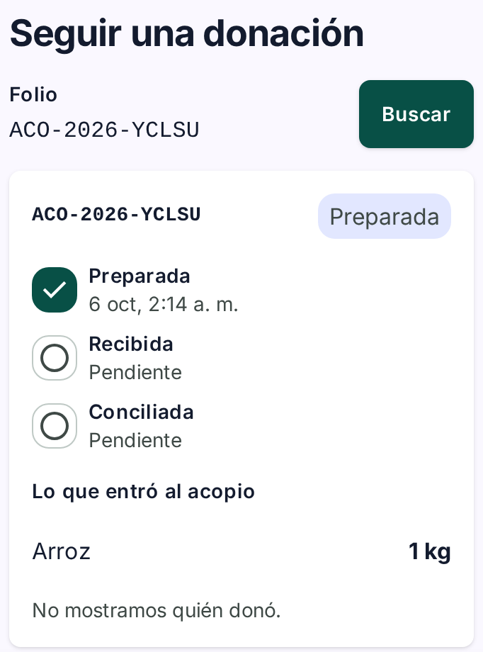

### Motor de traslados y recepción

El motor multiplica la cantidad diaria por persona por la población y los días del periodo. Descuenta lo recibido y lo que está en camino. Después compara el déficit con las existencias que el acopio puede mover teniendo en cuenta sus umbrales, los productos vencidos y lo ya comprometido. La Figura 5 muestra el desglose del puntaje en criticidad, urgencia, proximidad y magnitud (Equipo Acopio, 2026g).

Por ejemplo, si una zona necesita 100 unidades, recibió 30 y espera 20, todavía le faltan 50. Un centro que pueda entregar 35 cubriría hasta 35 en ese traslado.

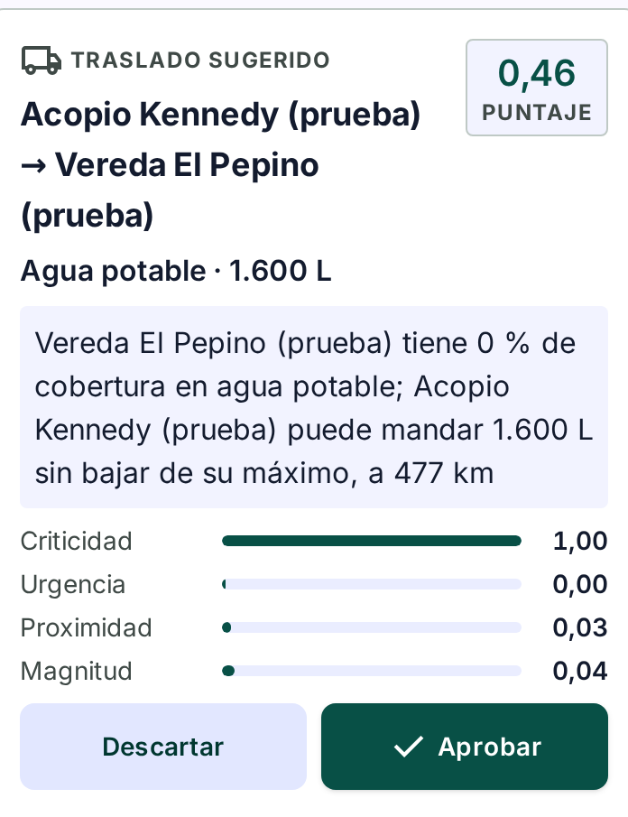

El Administrador revisa y puede ajustar la cantidad antes de aprobar. El aviso de la Figura 6 explica que la aprobación agrega el traslado a una remisión en borrador o crea una si hace falta (Equipo Acopio, 2026e, sección 1a).

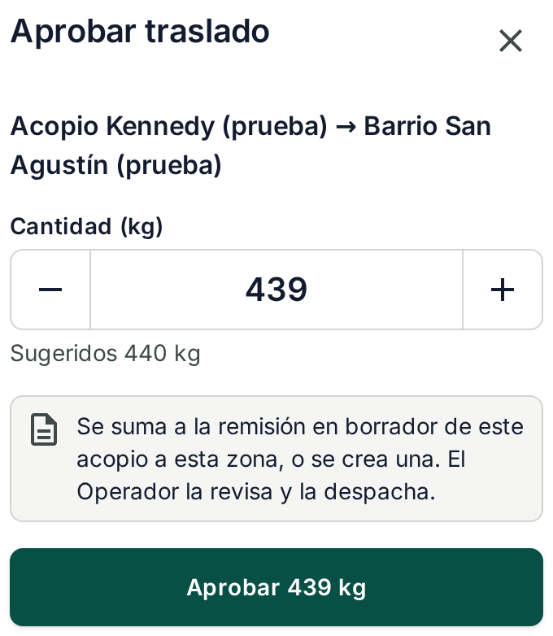

El Administrador o el Operador del centro de origen puede despachar la remisión. La Figura 7 muestra el responsable y el folio seleccionado antes de confirmar. La Figura 8 muestra el documento generado para ese despacho, con el mismo código y su QR (Equipo Acopio, 2026e, 2026i).

El Receptor asignado confirma la cantidad que llegó y adjunta una foto. La Figura 9 muestra la confirmación de otra remisión de demostración (Equipo Acopio, 2026e, 2026i).

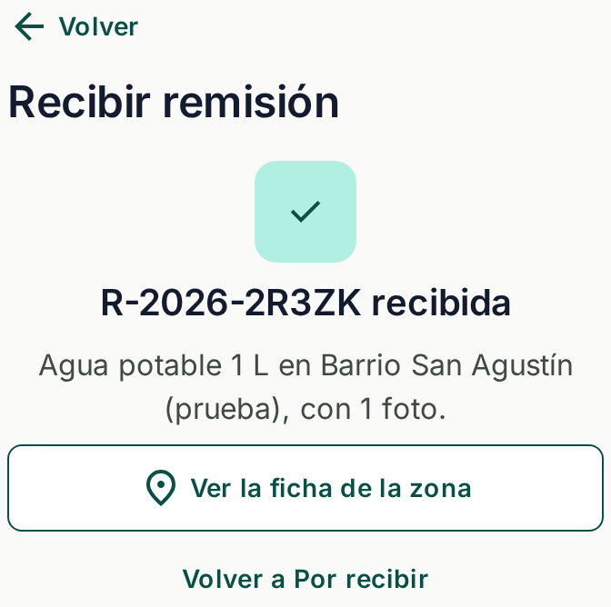

### Portal público y voluntariado

El mapa distingue los centros de Acopio de los puntos referenciados de RedAcopio Bogotá. La leyenda de la Figura 10 identifica el origen de los datos para que el visitante sepa qué tipo de punto está consultando (Equipo Acopio, 2026e, sección 1c).

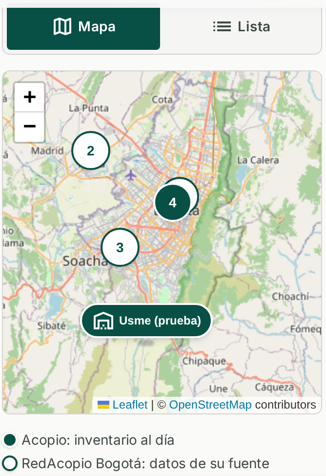

Las personas pueden consultar causas de entidades verificadas. La Figura 11 muestra el sello y la fecha de verificación en la ficha. Para aportes monetarios, la ficha dirige al sitio oficial de la entidad (Equipo Acopio, 2026e, sección 1b).

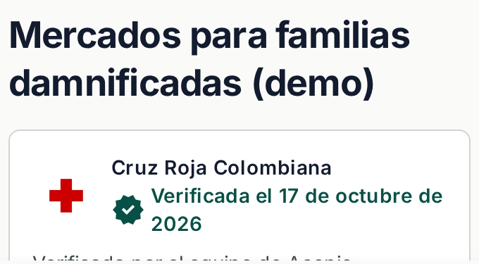

La Figura 12 muestra el paso previo al sello: el Administrador confirma que revisó la entidad y su sitio oficial. En la captura, la casilla sigue sin marcar y el botón de verificación está inactivo. El formulario de publicación solo ofrece entidades verificadas (Equipo Acopio, 2026e, sección 1b).

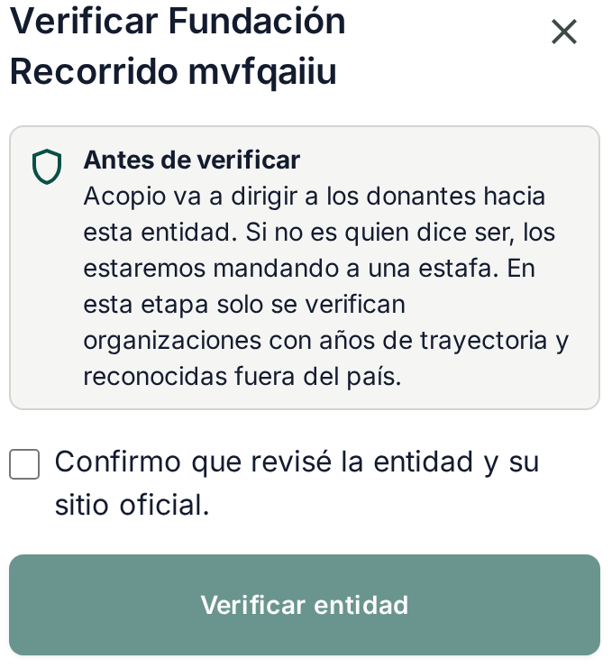

Los voluntarios pueden reservar jornadas con cupo. La confirmación indica el código, la fecha, el horario y el lugar. La Figura 13 permite distinguir esa confirmación de la pantalla donde se solicita el cupo (Equipo Acopio, 2026e, sección 1c).

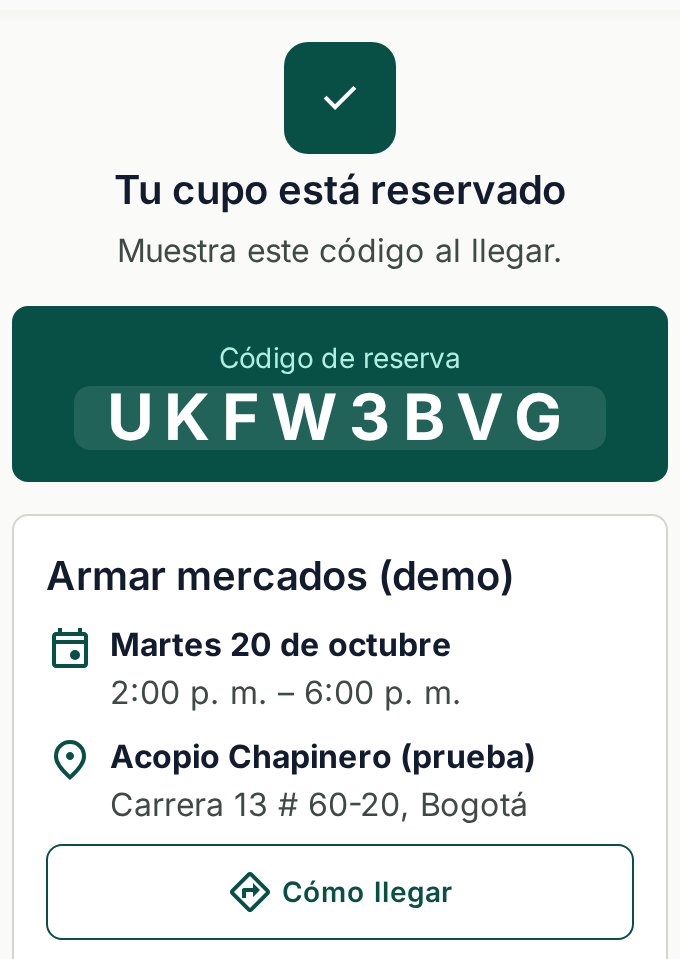

### Alcances

El prototipo cubre la consulta pública, el inventario, el seguimiento de donaciones, los traslados y las reservas. Se evaluó con recorridos de desarrollo. Queda por comprobar su utilidad en una respuesta real y su desempeño con conectividad intermitente.

## Resultados

El Avance 5 documenta el recorrido desde la sugerencia hasta la recepción, además de la verificación de entidades y las pantallas de voluntariado. En la corrida local del 19 de octubre, la guía registra nueve de nueve comprobaciones del motor, siete de siete del despacho y siete de siete de la recepción. Son resultados de pruebas de software con datos de demostración (Equipo Acopio, 2026e, 2026i).

La revisión del 19 de octubre, realizada por un integrante con cuentas de demostración, confirmó que el sistema bloqueaba un traslado que excedía la cantidad disponible. Registró también que faltaba una advertencia de inventario desactualizado y que una pantalla podía abrirse aunque la API denegara el cambio. Estas observaciones muestran por qué conviene probar la interfaz y la autorización de la API por separado (Equipo Acopio, 2026h).

## Análisis de resultados y conclusiones

Los recorridos muestran que el prototipo relaciona una sugerencia con el despacho y la confirmación de llegada. El Administrador puede revisar la justificación antes de aprobar el traslado y el Receptor deja constancia de lo que efectivamente llegó. Los resultados corresponden a pruebas con datos de demostración. El equipo aún no ha medido tiempos de entrega, adopción ni impacto en una emergencia.

La investigación de la canasta mostró que un cálculo puede funcionar como se diseñó y seguir dependiendo de supuestos que requieren revisión. Una prueba de campo debería comprobar si los equipos pueden mantener los registros al día, interpretar las sugerencias y contrastarlas con las necesidades locales. Antes de usar la canasta en operaciones reales se necesita revisar su composición y los datos de población con personal especializado.

## Referencias

APC Colombia. (2026, 12 de agosto). *Orientaciones para articular las donaciones y ayudas humanitarias destinadas a las víctimas del terremoto*. https://www.apccolombia.gov.co/comunicaciones/noticias/apc-colombia-emite-orientaciones-para-articular-las-donaciones-y-ayudas

Asociación Esfera. (2018). *El Manual Esfera: Carta Humanitaria y normas mínimas para la respuesta humanitaria* (4.ª ed.). https://spherestandards.org/wp-content/uploads/El-manual-Esfera-2018-ES.pdf

Departamento Administrativo Nacional de Estadística. (s. f.). *Proyecciones de población*. https://www.dane.gov.co/index.php/estadisticas-por-tema/demografia-y-poblacion/proyecciones-de-poblacion

Equipo Acopio. (2026a). *Avance 1: Sprint 0. Selección y definición inicial del producto* [Entrega de curso]. ETITC.

Equipo Acopio. (2026b). *Avance 2: Requisitos y planeación inicial* [Entrega de curso]. ETITC.

Equipo Acopio. (2026c). *Avance 3: Arquitectura inicial* [Entrega de curso]. ETITC.

Equipo Acopio. (2026d). *Avance 4: Sprint 1* [Entrega de curso]. ETITC.

Equipo Acopio. (2026e). *Avance 5: Sprint 2. Interfaz funcional y patrones de diseño* [Entrega de curso]. ETITC.

Equipo Acopio. (2026f). *Canasta estándar Acopio: Validación* [Informe interno de investigación].

Equipo Acopio. (2026g). *Código fuente del cálculo de necesidades y emparejamiento* [Código fuente]. GitHub. https://github.com/Proyecto-IngSoftware/acopio/tree/main/packages/shared/src/motor

Equipo Acopio. (2026h, 19 de octubre). *Ronda de pruebas por rol en el servidor* [Informe de sesión]. GitHub. https://github.com/Proyecto-IngSoftware/acopio/blob/main/docs/06-operacion/sesiones/2026-10-19-ronda-por-rol.md

Equipo Acopio. (2026i, 30 de octubre). *Recorridos de punta a punta* [Registro de pruebas]. GitHub. https://github.com/Proyecto-IngSoftware/acopio/blob/main/docs/06-operacion/recorridos.md

Unidad Nacional para la Gestión del Riesgo de Desastres. (2013). *Manual de estandarización de ayuda humanitaria de Colombia*. https://portal.gestiondelriesgo.gov.co/Documents/Manuales/Manual_de_Estandarizacion_AHE_de_Colombia.pdf

## Anexos

### Primera entrega

El equipo comparó Acopio, AulaLibre y MediRuta. La matriz del Sprint 0 les asignó 31, 26 y 22 puntos sobre 35, respectivamente. AulaLibre obtuvo mejor valoración en viabilidad técnica y temporal. El equipo eligió Acopio por el problema observado y por la posibilidad de construir y demostrar la operación de inventario y reparto en etapas (Equipo Acopio, 2026a).

### Segunda entrega

El segundo avance documentó los requisitos, los roles y las historias de usuario que alimentaron el plan de trabajo. Las Figuras B1 y B2 presentan recorridos del público y del personal. El diagrama completo del Avance 2 incluye los demás casos de uso y sus relaciones (Equipo Acopio, 2026b).

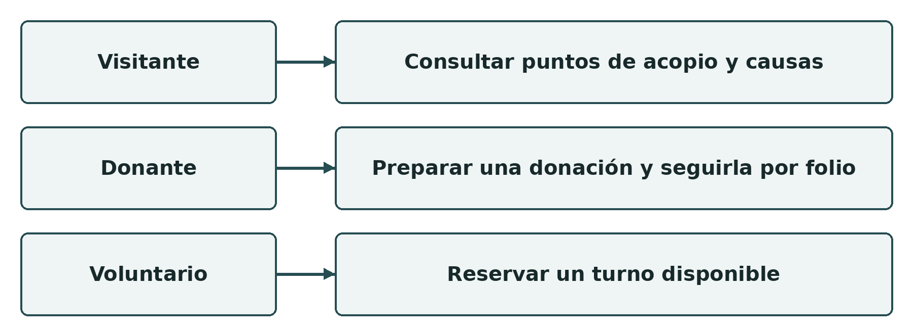

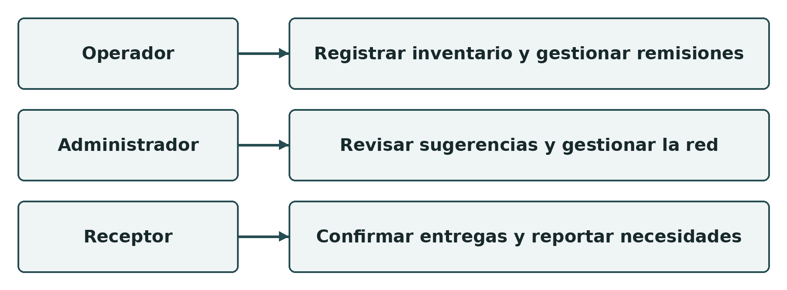

### Tercera entrega

El tercer avance definió la arquitectura inicial, la separación de responsabilidades y el modelo de datos. La Figura C1 presenta los componentes del sistema en ejecución. La Figura 2, en cambio, muestra la organización del código en el repositorio (Equipo Acopio, 2026c).

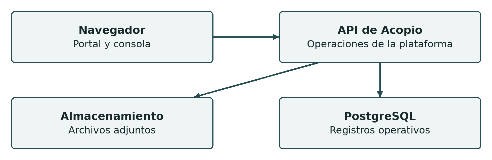
